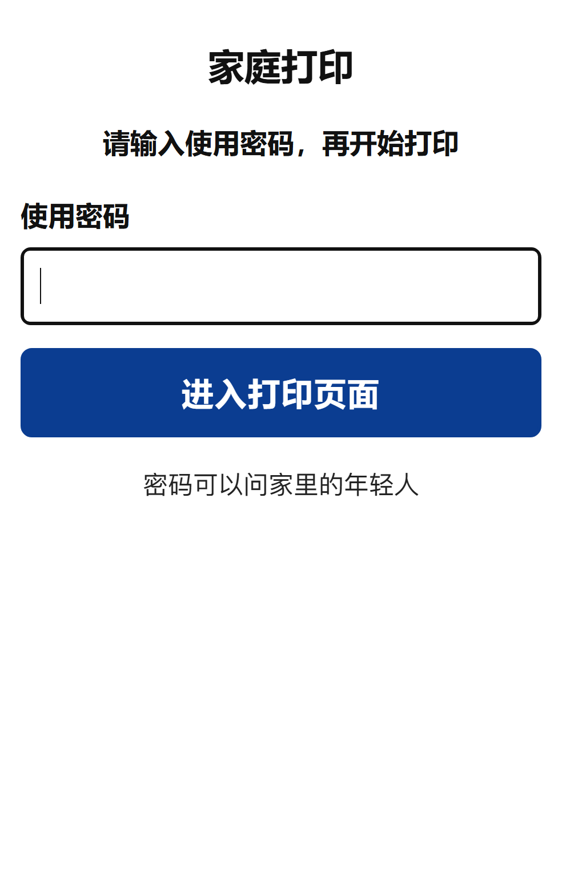

<div align="center">



# 家庭内网打印

**让爸妈和孩子也会用的家庭打印工具。手机连上同一个 WiFi，微信扫码，输入密码，打字、选照片，或从手机/微信聊天记录里选文件，预览后一键打印。**

[简体中文](README.md) · [English](README_EN.md)

[](https://github.com/ShirakawaFM/family-lan-printer/releases)
[](https://www.python.org/)
[](https://www.microsoft.com/windows)
[](https://flask.palletsprojects.com/)
[](LICENSE)
[](https://github.com/ShirakawaFM/family-lan-printer/stargazers)

</div>

> ⚠️ **不是云打印，也不会上传任何内容。** 所有文字、图片和文件只在你这台 Windows 电脑的局域网内处理，打印完 30 秒自动删除临时文件；只预览未打印的文件 30 分钟后自动清理。
>
> 本项目是个人自用工具，与微信、打印机厂商没有任何关系。

---

## 目录

- [项目简介](#项目简介)
- [页面预览](#页面预览)
- [功能特性](#功能特性)
- [工作原理](#工作原理)
- [快速开始](#快速开始)
- [使用流程](#使用流程)
- [配置项](#配置项)
- [打印规则](#打印规则)
- [安全设计](#安全设计)
- [外网访问（frp，可选）](#外网访问frp可选)
- [Windows 开机自启](#windows-开机自启)
- [项目结构](#项目结构)
- [已知限制](#已知限制)
- [常见问题 FAQ](#常见问题-faq)
- [开发与测试](#开发与测试)
- [贡献](#贡献)
- [许可证](#许可证)
- [免责声明](#免责声明)

---

## 项目简介

家里的打印机接在 Windows 电脑上。年轻人想打印东西，要开电脑、找文件、点打印；老人和孩子更不可能自己完成。

这个项目把流程压缩成三步：

1. 电脑上运行一个单文件 Python 服务；
2. 把生成的 `qr_wall.png` 打印出来贴在打印机旁边；
3. 手机连家里 WiFi，微信扫码 → 输入密码 → 打字、选照片，或选文件预览后打印。

没有 App、没有注册账号、没有云端同步、没有广告。网页做三件事：**打印文字**、**打印图片**、**预览并打印手机文件/微信聊天文件**。

适合这些场景：

- 给孩子打印作业、通知、错题；
- 给老人打印药盒说明、地址、电话号码；
- 打印手机里刚拍的照片、截图、证件照；
- 打印微信聊天里收到的 PDF、Word、Excel、PPT、TXT；
- 家里只有一台 Windows 电脑连着打印机，其他人都用手机。

---

## 页面预览

> 截图里的二维码是演示链接 `http://192.168.1.100:5000`，不是真实可扫地址。

| 密码页 | 打印主页 |
| :---: | :---: |
|  |  |

页面没有导航栏、广告、动画和装饰图。所有文字最小 22px，按钮通栏、80px 高、深蓝底白字，专门照顾老人和小孩的触屏操作。文件先显示前 3 页预览，确认后再打印全部页面。

---

## 功能特性

| 功能 | 具体实现 |
| --- | --- |
| **扫码即用** | 启动时自动检测本机局域网 IPv4，生成访问链接与二维码 |
| **贴墙二维码** | 自动导出 `qr_wall.png`，300 DPI 高清黑白图，可直接打印贴墙 |
| **共享密码** | 全家共用一个使用密码，不是注册登录；密码只在控制台脱敏显示 |
| **文字打印** | 大文本框，A4 纸、宋体 24 号、左对齐、固定 20mm 页边距、自动换行和分页 |
| **图片打印** | 只接受 jpg / png / webp，单文件 8MB；自动摆正、等比缩放、A4 居中，不拉伸不裁切 |
| **手机文件 / 聊天文件** | 文件选择器支持 PDF、Word、Excel、PPT、TXT、HTML、图片；微信聊天文件在系统文件选择器里选「聊天文件」 |
| **打印前预览** | 文件先在手机上显示前 3 页真实排版预览，点「确认打印」才打印全部页面，防止误打几十页 |
| **保持原版式** | PDF 直接渲染；Word/Excel 通过本机 Microsoft Office 转 PDF；PPT 逐页导出 PNG，版式不变 |
| **串行队列** | 所有任务进入线程安全队列，由唯一的后台线程依次打印，避免多任务把打印机搞崩 |
| **临时文件自动清理** | 文字、图片和文件都先存到 `temp_print/`，任务结束 30 秒后自动删除；只预览未打印的文件 30 分钟后清理 |
| **友好错误** | 前端只显示两种中文提示，不输出 Python 堆栈或英文错误码；详细日志留在控制台 |
| **串行状态轮询** | 提交后显示「正在排队打印」，实际打印失败会自动变成「打印失败」提示 |
| **外网访问教程** | 代码末尾附带 frp 内网穿透完整教程；网页永远只展示内网二维码 |
| **开机自启教程** | 代码末尾附带 Windows 任务计划程序详细步骤，开机自动运行 |
| **单文件部署** | 业务代码只有 `print_server.py` 一个文件，不生成前端构建产物 |

**明确不做：** OCR、微信机器人、云盘同步、WiFi 配网二维码、用户注册、排版选项、图片裁剪。网页不能直接读取微信聊天数据库，只能通过手机/微信提供的文件选择器选择聊天文件。

---

## 工作原理

### 架构

```text
手机微信 / 手机浏览器
        │  HTTP（同一个 WiFi）
        ▼
┌──────────────────────────────────────────────┐
│  Flask  0.0.0.0:5000                         │
│                                              │
│  GET  /              密码页 / 打印主页       │
│  POST /unlock        校验共享密码，写入会话  │
│  POST /print/text    文字 → temp_print/*.txt │
│  POST /print/image   图片校验 → temp_print/* │
│  POST /print/file    文件预览（PDF/Office/  │
│                      TXT/HTML/图片）         │
│  POST /print/file/id 确认打印已预览文件      │
│  GET  /status/<id>   查询任务状态            │
└──────────────────────┬───────────────────────┘
                       │ queue.Queue（FIFO）
                       ▼
┌──────────────────────────────────────────────┐
│  唯一的 print-worker 后台线程                │
│                                              │
│  文字：读取 txt → Pillow 排 A4 → 逐页打印   │
│  图片：EXIF 摆正 → 等比 contain → A4 居中   │
│  PDF：pypdfium2 渲染每页 → 逐页打印          │
│  Office：Office COM → PDF → 逐页打印        │
│  PPT：Slide.Export PNG → A4 逐页打印        │
│  打印：pywin32 / win32ui → Windows 默认打印机│
└──────────────────────┬───────────────────────┘
                       │
                       ▼
               Windows 默认打印机
                       │
              打印完成/失败后 30 秒
                       ▼
              删除对应 temp_print 文件
```

### 为什么用“单消费者队列”

Windows 打印驱动和 spooler 对并发提交并不总是友好：两个任务同时 `StartDoc` 可能导致顺序错乱、驱动卡死、甚至打印机脱机。这里只开一个 `print-worker` 线程消费 `queue.Queue`，无论手机端同时点多少次，都严格按提交顺序一张一张打印。

### 文字打印链路

1. 前端把文字 `POST /print/text`；
2. 服务端写入 `temp_print/<task_id>.txt`；
3. worker 读取 txt，使用 Pillow 以 300 DPI 排成 A4 页面；
4. 宋体 24 号、20mm 页边距、左对齐、自动换行、自动分页；
5. 每一页转成 DIB，通过 `pywin32` 的打印机 DC 输出；
6. 任务结束（无论成功失败）30 秒后删除 txt。

### 图片打印链路

1. 前端 `POST /print/image`（multipart）；
2. 检查后缀、8MB 上限、实际图片格式和像素尺寸；
3. 保存到 `temp_print/<task_id>.<ext>`；
4. worker 用 Pillow 处理 EXIF 方向、透明背景、颜色模式；
5. `ImageOps.contain` 等比缩放到 A4 页边距以内，居中贴到白底 A4 页面；
6. 通过默认打印机输出；
7. 任务结束 30 秒后删除图片。

### 文件 / 聊天文件打印链路

1. 前端选择手机文件或微信聊天文件，`POST /print/file`；
2. 保存到 `temp_print/file_<id>/`，检查 50MB 上限和文件格式；
3. 按类型准备：
   - PDF：`pypdfium2` 读取页数，渲染前 3 页预览；
   - Word / Excel：调用本机 Microsoft Office 转成 PDF，再走 PDF 流程；
   - PPT：调用 PowerPoint 把每页导出成 PNG，保持原版式；
   - TXT / HTML / JSON：解码、去标签，按 A4 文字规则排版；
   - 图片：按 A4 图片规则处理；
4. 手机显示前 3 页真实排版预览和总页数；
5. 用户点「确认打印这份文件」后，`POST /print/file/<id>` 才进入打印队列；
6. 打印全部页面，结束后 30 秒删除整个临时目录；只预览没打印的，30 分钟后自动清理。

### 页面顺序

密码页通过后，打印主页严格按以下顺序排列：

1. 同 WiFi 提示；
2. 内网二维码；
3. 文字打印模块；
4. 图片打印模块；
5. 手机文件 / 微信聊天文件模块（预览 + 确认打印）；
6. 状态提示区。

---

## 快速开始

### 环境要求

| 项目 | 要求 |
| --- | --- |
| 系统 | Windows 10 / Windows 11 |
| Python | 3.10 或更高（已在 3.14 上验证） |
| Python 依赖 | Flask、Pillow、qrcode、pypdfium2、pywin32 |
| 打印机 | 已在 Windows 中安装，并设置为**默认打印机** |
| 网络 | 电脑和手机连接同一个 WiFi / 局域网 |
| 纸张 | 打印机纸盒设置为 A4 |
| Office | 打印 Word/Excel/PPT 时需要本机安装 Microsoft Office；PDF/TXT/HTML/图片不需要 |

### 1. 安装依赖

```bat
cd /d D:\家庭打印
python -m pip install -r requirements.txt
```

如果 `python` 不是内部命令，安装 Python 时记得勾选 **Add Python to PATH**，或者使用 `py -3.12`。

### 2. 修改访问密码

打开 `print_server.py`，在最上面的用户配置区找到：

```python
ACCESS_PASSWORD = "123456"
```

改成家里自己的密码。默认密码 `123456` 只用于第一次跑通，**不要直接长期使用**。

### 3. 启动

```bat
python print_server.py
```

控制台会输出：

```text
✅ 本机内网访问地址：http://192.168.1.100:5000
✅ 墙上二维码图片已导出：qr_wall.png
✅ 访问密码：1****6
✅ 提示：保持电脑开机、打印机开机才能正常使用
```

首次启动如果 Windows 防火墙弹窗，请允许 **专用网络**。不要关闭这个控制台窗口；关闭窗口服务就停了。

### 4. 打印贴墙二维码

把程序目录下生成的 `qr_wall.png` 用打印机打印出来，贴在打印机旁边。

手机连家里 WiFi，微信扫这张图 → 输入密码 → 开始打印。

### 5. 测试打印

建议先打一行字：

```text
测试打印：今天下午三点吃药
```

确认打印机、纸张、默认打印机都正常，再把二维码贴到墙上。

---

## 使用流程

给家人的说明可以直接打印出来贴墙上：

1. 手机连上家里的 WiFi（和打印电脑同一个 WiFi）；
2. 微信扫墙上的二维码；
3. 输入使用密码；
4. 想打印文字：在框里打字，点蓝色「打印文字」；
5. 想打印照片：点「选择手机相册图片打印」，选图，点蓝色「打印图片」；
6. 想打印文件/聊天文件：点「打印手机文件 / 微信聊天文件」里的文件框，选文件后点「预览文件」，确认预览效果，再点「确认打印这份文件」；
7. 看到「✅ 提交成功，正在排队打印」就是提交成功；
8. 如果看到「❌ 打印失败，请检查打印机开机、连线、缺纸」，叫家里人检查打印机。

---

## 配置项

所有配置都在 `print_server.py` 顶部：

| 配置 | 默认值 | 说明 |
| --- | --- | --- |
| `HOST` | `"0.0.0.0"` | 监听所有网卡，同一 WiFi 的手机才能访问 |
| `PORT` | `5000` | 网页端口；被占用时可改成 `5001`，访问链接同步变化 |
| `ACCESS_PASSWORD` | `"123456"` | 全家共用的访问密码，务必修改 |
| `ENABLE_FRP_GUIDE` | `True` | 控制台是否提示代码末尾有 frp 教程；网页不展示外网二维码 |
| `EXPORT_QR_IMAGE` | `True` | 启动时是否生成 `qr_wall.png` |
| `QR_WALL_FILENAME` | `"qr_wall.png"` | 贴墙二维码文件名 |
| `LAN_IP_OVERRIDE` | `""` | 多网卡/VPN 自动识别错误时，手工指定局域网 IPv4 |
| `TEMP_DIR_NAME` | `"temp_print"` | 临时文件目录名 |
| `PAGE_MARGIN_MM` | `20.0` | A4 页边距（毫米） |
| `TEXT_FONT_SIZE_PT` | `24` | 文字字号（磅） |
| `TEXT_LINE_SPACING` | `1.5` | 行距倍数 |
| `RENDER_DPI` | `300` | 页面渲染 DPI |
| `IMAGE_MAX_BYTES` | `8388608` | 单张图片上限 8MB |
| `MAX_IMAGE_PIXELS` | `50000000` | 图片像素上限，防止超大图占满内存 |
| `MAX_TEXT_CHARS` | `20000` | 单次文字上限，约几十页 |
| `FILE_MAX_BYTES` | `52428800` | 手机文件/聊天文件上限 50MB |
| `FILE_PREVIEW_PAGES` | `3` | 手机预览前几页 |
| `FILE_PREVIEW_DPI` | `96` | 预览渲染 DPI |
| `PDF_PRINT_DPI` | `200` | PDF 正式打印 DPI |
| `MAX_FILE_TEXT_CHARS` | `50000` | TXT/HTML 类文件最多 5 万字 |
| `FILE_TTL_SECONDS` | `1800` | 只预览未打印的文件保留 30 分钟 |
| `DELETE_AFTER_SECONDS` | `30` | 任务结束后延迟删除临时文件的秒数 |
| `SESSION_LIFETIME_DAYS` | `30` | 手机登录状态保留天数 |

---

## 打印规则

### 文字

| 项目 | 规则 |
| --- | --- |
| 纸张 | A4 纵向 |
| 字体 | 宋体（缺少时自动回退到微软雅黑/等线/黑体） |
| 字号 | 24 号 |
| 对齐 | 左对齐 |
| 页边距 | 固定 20mm |
| 换行 | 中文按字、英文按单词/网址整体换行，超长单词强制拆分 |
| 分页 | 自动分页，不打印只有空行的空白页 |
| 选项 | 前端不提供字号、行距、边距、纸型等任何排版选项 |

### 图片

| 项目 | 规则 |
| --- | --- |
| 格式 | jpg / jpeg / png / webp |
| 大小 | 单文件不超过 8MB |
| 方向 | 自动读取 EXIF 方向，手机竖拍照片不会横着打 |
| 缩放 | 等比缩放到 A4 页边距以内，不拉伸、不变形 |
| 位置 | 页面居中 |
| 透明图 | 透明区域铺白底 |
| 裁切 | 不裁切，完整保留画面 |

### 手机文件 / 微信聊天文件

| 类型 | 处理方式 |
| --- | --- |
| PDF | `pypdfium2` 渲染每页，保留原版式，预览前 3 页 |
| Word（doc/docx/rtf/odt） | 调用本机 Word 转 PDF，再渲染预览/打印 |
| Excel（xls/xlsx/csv/ods） | 调用本机 Excel 转 PDF，再渲染预览/打印 |
| PPT（ppt/pptx/odp） | 调用 PowerPoint 逐页导出 PNG，按 A4 预览/打印，保持版式 |
| TXT / HTML / JSON | 自动识别 UTF-8/GB18030 等编码，HTML 去标签，按 A4 文字重排 |
| 图片（jpg/png/webp） | 按图片规则适配 A4 |

- 文件上限 50MB；TXT/HTML 文字最多 5 万字。
- 手机端只显示前 3 页预览和总页数，确认后打印全部页面。
- 只预览、不打印的文件 30 分钟后自动清理。
- 网页不能直接读取微信聊天数据库；在文件选择器里选「聊天文件」或先保存到手机再选。

### 打印机

- 必须使用 Windows 默认打印机；
- 打印前会尽力读取打印机状态，识别暂停、报错、卡纸、缺纸、离线、缺墨、盖未关等状态；
- 如果驱动不上报状态，最终以 Windows spooler 的返回结果为准；
- 打印机纸张请设置为 A4，程序按 A4 版面排版。

---

## 安全设计

- **共享密码 + 会话**：不是用户注册系统，只是全家共用一个密码；登录状态默认保留 30 天。
- **内网二维码**：`qr_wall.png` 只包含局域网地址，不包含外网地址。
- **外网不生成二维码**：即使开启 frp，网页也只展示内网二维码；外网地址需要自己保存。
- **临时文件自动清理**：文字、图片、文件最长只保留到任务结束后 30 秒；只预览未打印的文件 30 分钟后清理。
- **无云端**：没有第三方 API、没有上传、没有统计、没有广告。
- **前端错误隔离**：所有打印异常只在控制台记录，网页只显示统一中文提示。
- **文件校验**：图片同时检查后缀、大小、Pillow 实际解码格式和像素上限；文档检查后缀、大小、PDF/Office 是否真的能打开。
- **会话 Cookie**：`HttpOnly` + `SameSite=Lax`；局域网 HTTP 场景下不启用 `Secure`。
- **frp 外网建议**：如果长期公网使用，请在云服务器前面加 Nginx/Caddy + HTTPS，并设置强密码和 frp token。公网 HTTP 会让密码以明文经过网络。

> 这个工具的安全边界是“家庭局域网 + 共享密码”，不是企业级身份认证。不要把它直接暴露在公网而不加 HTTPS/访问控制。

---

## 外网访问（frp，可选）

默认只支持同一个 WiFi。如果确实需要在 4G/5G 下使用，可以用 frp 把内网端口映射到有公网 IP 的云服务器。

> 网页界面永远只显示内网二维码；外网地址不要贴墙，也不要发到群里。

### 服务端 `frps.ini`

```ini
[common]
bind_port = 7000
token = 换成一段很长的随机密码
```

### 家里电脑 `frpc.ini`

```ini
[common]
server_addr = 你的云服务器公网IP
server_port = 7000
token = 换成和 frps.ini 完全一样的随机密码

[family_print]
type = tcp
local_ip = 127.0.0.1
local_port = 5000
remote_port = 6000
```

启动：

```bat
frps.exe -c frps.ini
frpc.exe -c frpc.ini
```

外网访问：

```text
http://你的公网IP:6000
```

云服务器安全组放行 `7000/TCP` 和 `6000/TCP`。完整下载地址、Windows/Linux 启动方式、HTTPS 建议、开机自启和排错步骤，见 `print_server.py` **文件末尾的完整 frp 教程注释**。

---

## Windows 开机自启

推荐用“任务计划程序”而不是启动文件夹，步骤简述：

1. `Win + R` → `taskschd.msc`；
2. 右侧“创建任务”；
3. 常规：只在用户登录时运行；
4. 触发器：登录时，延迟 30 秒；
5. 操作：启动 `python.exe` 或 `pythonw.exe`；
6. 参数填 `"D:\家庭打印\print_server.py"`（带引号）；
7. 起始于填 `D:\家庭打印`；
8. 设置里允许失败重启，取消“运行超过以下时间停止任务”。

建议先用 `python.exe` 运行，能看到控制台和报错；确认稳定后再换 `pythonw.exe` 隐藏窗口。完整步骤和注意事项见代码末尾注释。

---

## 项目结构

```text
family-lan-printer/
├─ print_server.py              # 唯一业务文件：Flask + 打印 + 队列 + 网页
├─ requirements.txt             # Python 依赖
├─ README.md                    # 中文说明
├─ README_EN.md                 # English README
├─ LICENSE                      # MIT
├─ CHANGELOG.md
├─ assets/
│  └─ banner.svg
├─ docs/
│  ├─ screenshot-login.png
│  └─ screenshot-print.png
└─ .github/
   └─ workflows/
      └─ python-check.yml       # 语法检查 CI
```

运行后会额外生成（已在 `.gitignore` 中忽略）：

```text
temp_print/                     # 临时文字、图片、文件目录，30 秒/30 分钟自动清理
qr_wall.png                     # 贴墙二维码，包含你的局域网 IP，不建议提交到仓库
server.log / server.err.log     # 可选运行日志
```

---

## 已知限制

- 只支持 Windows；依赖 `pywin32` 调用 Windows 打印 API。
- 只支持 Windows 默认打印机，不能在网页里切换打印机。
- 打印机状态依赖驱动上报；部分廉价/虚拟打印机不上报离线、缺纸，程序可能只能确认“已提交给 spooler”。
- 页面按 A4 纵向设计，打印机纸盒需要设置为 A4。
- 电脑 IP 变化后，需要重新运行程序生成新的 `qr_wall.png`。
- 如果使用 `pythonw.exe` 自启，没有控制台日志；排错时请改用 `python.exe`。
- 文件打印保留原版式；但文字/聊天记录本身是纯文本，会按 A4 宋体重新排版。
- Word/Excel/PPT 需要电脑安装 Microsoft Office；没有 Office 时请把文件另存为 PDF。Office 转换会调用本机 Office，首次可能慢几秒。
- 网页不能直接读取微信聊天数据库，只能通过手机/微信弹出的文件选择器选「聊天文件」；不同微信版本入口名称可能不同。
- 文件预览只展示前 3 页，打印会输出全部页面；超长文件/超大 PDF 的实际出纸量由用户确认。
- 手机和电脑必须在同一个局域网；跨网段、访客 WiFi、AP 隔离会导致打不开。

---

## 常见问题 FAQ

### 手机扫码提示 `ERR_CONNECTION_REFUSED`

服务没有启动，或者启动后窗口被关闭了。先在电脑上打开：

```text
http://127.0.0.1:5000
```

能打开说明服务正常；手机再连同一个 WiFi，用控制台显示的 `http://电脑IP:5000` 访问。仍然不行就检查 Windows 防火墙是否允许 Python 访问专用网络。

### 电脑上能打开，手机打不开

按顺序检查：

1. 手机和电脑是否同一个 WiFi；
2. 是否用了访客网络 / AP 隔离；
3. Windows 防火墙是否放行 Python；
4. 控制台显示的 IP 是否是手机能访问的网段；
5. 多网卡/VPN 时，在顶部设置 `LAN_IP_OVERRIDE` 为正确的局域网 IP。

### 二维码贴墙上后，IP 变了怎么办

重新运行 `python print_server.py`，会覆盖生成新的 `qr_wall.png`；重新打印贴墙即可。建议在路由器里给打印电脑绑定固定 IP。

### 提示没有默认打印机

Windows 设置 → 蓝牙和其他设备 → 打印机和扫描仪 → 选择打印机 → 设为默认值。然后用记事本随便打印一页，确认 Windows 自己能打印。

### 点打印后没反应 / 提示失败

先确认打印机开机、在线、有纸、盖好；再看控制台完整错误。网页只显示统一提示，详细原因在控制台日志里。

### 图片上传失败

只支持 jpg / png / webp，单文件不超过 8MB，且图片不能损坏。手机 HEIC 照片请先转成 jpg。

### 手机文件预览失败 / 提示 Office 无法打开

先确认文件本身能在电脑上用 Word/Excel/PPT 打开；没有安装 Microsoft Office 的电脑无法保留 Office 原版式，请先把文件另存为 PDF。PDF/TXT/HTML/图片不需要 Office。

### 微信聊天文件在哪里选

点文件选择框后，在手机/微信弹出的选择器里找「聊天文件」或「手机文件」。如果当前微信版本没有这个入口，先在微信里把文件保存到手机，再从文件选择器里选。

### 为什么文件只预览了 3 页

为了手机加载速度和防止误打，预览只显示前 3 页，标题里会写总页数；点「确认打印这份文件」会打印全部页面。

### 能不能在外网用

可以按上面的 frp 教程。但请一定改强密码，并尽量加 HTTPS；外网地址不要贴墙、不要公开分享。

### 为什么没有“打印完成”提示

本工具只承诺两件事：**提交成功** 和 **打印失败**。Windows spooler 接受任务后，无法 100% 知道纸张何时真正出来，所以不在前端编造“已打印完成”。

---

## 开发与测试

### 本地检查

```bat
python -m py_compile print_server.py
python print_server.py
```

CI 会在 Windows runner 上安装依赖并执行 `py_compile`，但不会真的打印（GitHub Actions 没有打印机）。

### 手动测试建议

1. 用记事本打印一页，确认 Windows 打印链路正常；
2. 启动服务，打开密码页；
3. 输入错误密码，确认只显示中文错误；
4. 输入正确密码，进入打印主页；
5. 打印一行短文字，检查 A4、宋体、24 号、20mm 边距；
6. 打印一张透明 PNG 和一张手机竖拍 JPEG，检查方向、比例、居中；
7. 上传一份 PDF，确认预览页数、确认打印、临时目录清理；
8. 如果装了 Office，再测试 Word/Excel/PPT 各一份；
9. 提交多个任务，确认串行打印；
10. 等待 30 秒，确认 `temp_print/` 已清空。

---

## 贡献

欢迎提 Issue 和 Pull Request，但请先确认：

- 保持单文件部署，不引入前端构建、数据库、云服务；
- 不增加 OCR、微信机器人、用户系统等需求外功能；
- 不把个人 IP、真实二维码、打印机名称、日志提交到仓库；
- 修改打印逻辑时，请说明是否在真实 Windows 打印机上测试过。

---

## 许可证

本项目使用 [MIT License](LICENSE) 开源。

Copyright (c) 2026 ShirakawaFM

---

## 免责声明

- 本项目为个人自用工具，不保证在所有 Windows 版本、打印机型号、驱动版本上都能正常工作。
- 打印内容由使用者自行提供，请遵守当地法律法规和家庭/单位规定。
- 因打印机离线、缺纸、驱动异常、网络配置、frp 暴露等原因造成的打印失败、纸张浪费或信息泄露，作者不承担责任。
- 使用外网访问前，请自行评估安全风险并配置 HTTPS、强密码和访问控制。

---

<div align="center">

如果这个项目帮到了你，点个 ⭐ 就是最大的支持。

</div>
