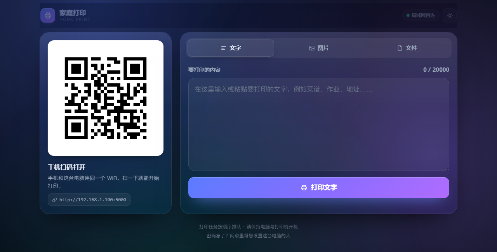
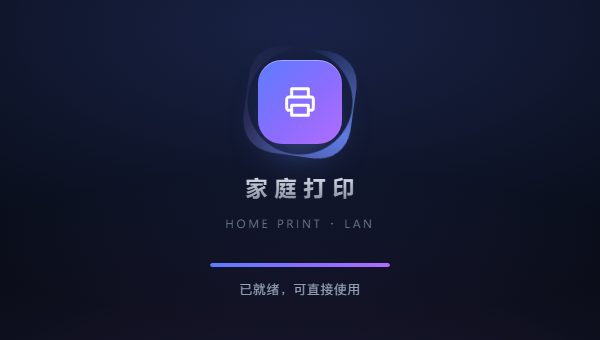
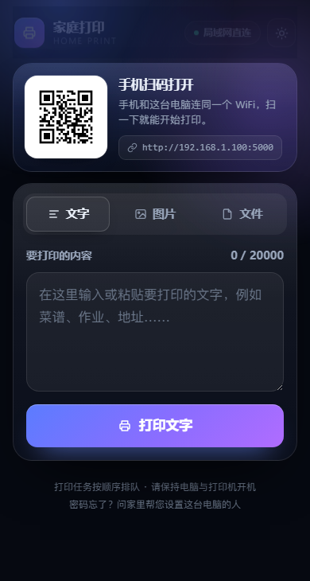
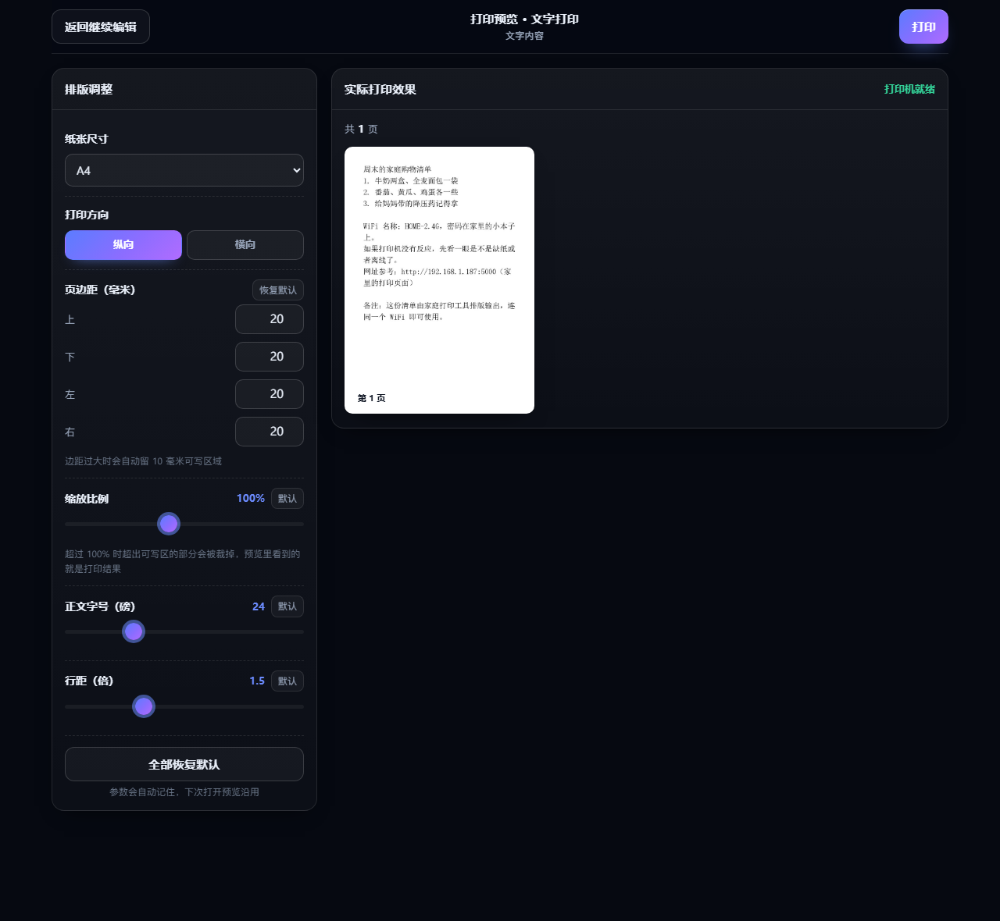
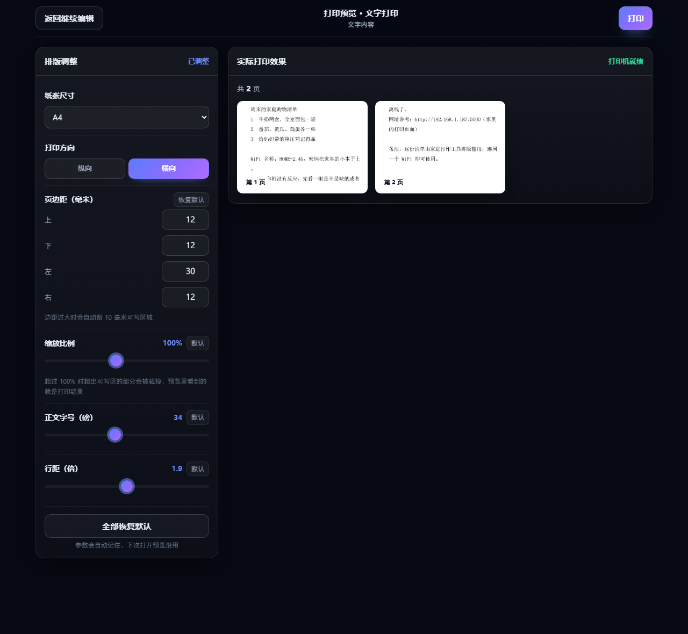
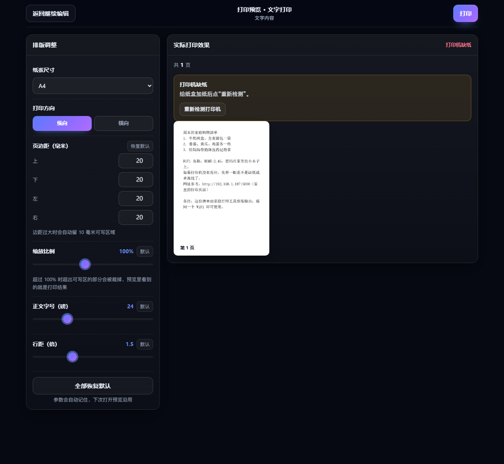
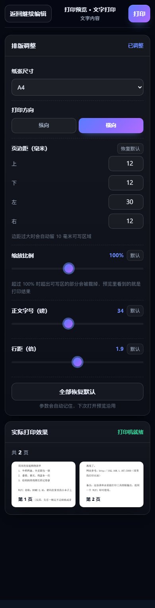
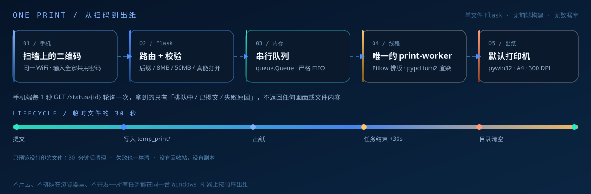

<div align="center">


**让爸妈和孩子也会用的家庭打印工具。手机连上同一个 WiFi，微信扫码，输入密码，打字、选照片，或从手机/微信聊天记录里选文件，预览后一键打印。**

简体中文 · [English](README_EN.md)

[](CHANGELOG.md)
[](https://github.com/ShirakawaFM/family-lan-printer/actions/workflows/python-check.yml)
[](https://www.python.org/)
[](https://www.microsoft.com/windows)
[](https://flask.palletsprojects.com/)
[](LICENSE)
[](https://github.com/ShirakawaFM/family-lan-printer/issues)
[](https://github.com/ShirakawaFM/family-lan-printer/stargazers)

</div>

> ⚠️ **不是云打印，也不会上传任何内容。** 所有文字、图片和文件只在你这台 Windows 电脑的局域网内处理，打印完 30 秒自动删除临时文件；只预览未打印的文件 30 分钟后自动清理。
>
> 本项目是个人自用工具，与微信、打印机厂商没有任何关系。

---

## 三步跑起来

<div align="center">
<code>① 装依赖</code>&nbsp; → &nbsp;<code>② 改密码</code>&nbsp; → &nbsp;<code>③ 启动扫码打印</code>
</div>

```bat
:: ① 装依赖（只需一次）
python -m pip install -r requirements.txt

:: ② 改密码：打开 print_server.py 顶部 ACCESS_PASSWORD
::    把默认的 123456 换成家里自己的密码

:: ③ 启动：控制台会打印二维码地址，并把 qr_wall.png 打印出来贴墙上
python print_server.py
```

手机上没有 App、不用注册，也不用连外网：**连同一个 WiFi → 微信扫墙上的二维码 → 输入密码 → 打印。** 完整步骤见 [快速开始](#快速开始)。

<div align="center">
<a href="#快速开始">🚀 快速开始</a>&nbsp; · &nbsp;<a href="#页面预览">🖼️ 页面预览</a>&nbsp; · &nbsp;<a href="#配置项">🔧 配置项</a>&nbsp; · &nbsp;<a href="#安全设计">🛡️ 安全设计</a>&nbsp; · &nbsp;<a href="#常见问题-faq">❓ 常见问题</a>&nbsp; · &nbsp;<a href="README_EN.md">🌐 English</a>
</div>

---

## 这版有什么不一样

| ✨ 亮点 | 说明 |
| :--- | :--- |
| 🎨 **现代动态界面** | 深浅色双主题（跟随系统，右上角可手动切换）、渐变光晕背景、玻璃质感卡片、弹簧微动效与 Toast 轻提示 |
| ⚡ **不到 1 秒启动** | 重型依赖按需加载、端口先绑定，首屏 gzip 后仅 ~4~16 KB，二次打开走 304 协商缓存 |
| 🎬 **品牌启动动画** | 约 1 秒的品牌 Splash，资源就绪后模糊淡出；系统开启「减弱动态效果」时自动降级 |
| 📱 **真的响应式** | 桌面双栏、手机单栏；手机上扫码卡压成横条，进页面就能直接看到输入框 |
| 📊 **上传有反馈** | 真实上传进度条 + 文件预览骨架屏，不再是「点了没反应」 |
| 👴 **仍然适老友好** | 正文不小于 16px、按钮通栏 56px 高、高对比配色，老人和小孩的触屏操作不受影响 |
| 🖨️ **打印前必预览** | 三个打印入口都先进预览页，内置排版编辑器（纸张 / 方向 / 四边边距 / 缩放 / 字号 / 行距），改完即时重排，所见即所得，只有「打印」和「返回继续编辑」两个出口 |
| 💬 **微信聊天文件直选** | 在微信里打开就能直接从聊天会话选文件，不用先存到手机；条件不满足时自动回落到系统文件选择器，不影响主流程 |
| 🔍 **启动即自检打印机** | 开机后台异步探测打印机状态，主页顶部常驻状态条，就绪 / 缺纸 / 离线一眼可见，带「重新检测」和「打印机设置」入口，不阻塞启动 |

---

## 目录

<details open>
<summary><b>展开 / 收起（24 节）</b></summary>

**开始之前**

- [这版有什么不一样](#这版有什么不一样) · [三步跑起来](#三步跑起来)
- [项目简介](#项目简介) · [页面预览](#页面预览) · [功能特性](#功能特性)

**装和用**

- [工作原理](#工作原理) · [快速开始](#快速开始) · [使用流程](#使用流程)
- [打印前预览（强制流程）](#打印前预览强制流程) · [微信聊天文件直选](#微信聊天文件直选)
- [启动时的打印机自检](#启动时的打印机自检)
- [打印规则](#打印规则) · [公网部署包（傻瓜式）](#公网部署包傻瓜式) · [Windows 开机自启](#windows-开机自启)

**想知道更多**

- [配置项](#配置项) · [安全设计](#安全设计) · [性能与资源占用](#性能与资源占用)
- [项目结构](#项目结构) · [已知限制](#已知限制) · [常见问题 FAQ](#常见问题-faq)

**维护**

- [开发与测试](#开发与测试) · [贡献](#贡献) · [许可证](#许可证) · [免责声明](#免责声明)

</details>

---

## 项目简介

家里的打印机接在 Windows 电脑上。年轻人想打印东西，要开电脑、找文件、点打印；老人和孩子更不可能自己完成。

这个项目把流程压缩成三步：

1. 电脑上运行一个单文件 Python 服务；
2. 把生成的 `qr_wall.png` 打印出来贴在打印机旁边；
3. 手机连家里 WiFi，微信扫码 → 输入密码 → 打字、选照片，或选文件预览后打印。

没有 App，不用注册，不同步云端，也没广告。网页就三个功能：打文字、打图片、把手机里或微信聊天里的文件预览一下再打。

适合这些场景：

- 孩子要打印作业、通知、错题；
- 老人要看药盒说明、地址、电话号码；
- 手机里刚拍的照片、截图、证件照；
- 微信聊天里收到的 PDF、Word、Excel、PPT、TXT；
- 家里只有一台 Windows 电脑连着打印机，其他人都用手机。

---

## 页面预览

### 桌面端 · 深色主题（默认跟随系统）

> 截图里的二维码是演示链接 `http://192.168.1.100:5000`，不是真实可扫地址。

<div align="center">
<a href="docs/screenshot-print.png"></a>
</div>

<details>
<summary><b>浅色主题 / 手机端 / 密码页 / 启动动画</b></summary>

<br>

<table>
<tr>
<td align="center" width="50%">
<a href="docs/screenshot-print-light.png"></a>
<br><sub><b>桌面端 · 浅色主题</b>：右上角可一键切换，跟随系统偏好自动记忆</sub>
</td>
<td align="center" width="50%">
<a href="docs/screenshot-splash.png"></a>
<br><sub><b>品牌启动动画</b>：约 1 秒，资源就绪后模糊淡出</sub>
</td>
</tr>
<tr>
<td align="center" width="50%">
<a href="docs/screenshot-login.png"></a>
<br><sub><b>手机密码页</b>：全家共用一个密码，不是注册登录</sub>
</td>
<td align="center" width="50%">
<a href="docs/screenshot-print-mobile.png"></a>
<br><sub><b>手机打印主页</b>：扫码卡压成横条，进页面就能看到输入框</sub>
</td>
</tr>
</table>

</details>

<br />

### 打印预览页（排版编辑器，所有打印必经）

<div align="center">
<a href="docs/screenshot-preview.png"></a>
</div>

<details>
<summary><b>横向排版 / 打印机异常提示 / 手机端预览页</b></summary>

<br>

<table>
<tr>
<td align="center" width="50%">
<a href="docs/screenshot-preview-landscape.png"></a>
<br><sub><b>改参数即时重排</b>：换成 A4 横向、12/30mm 边距、34 磅字后自动分成 2 页</sub>
</td>
<td align="center" width="50%">
<a href="docs/screenshot-preview-printer-error.png"></a>
<br><sub><b>打印机缺纸时</b>：预览页直接给出原因、处理办法与「重新检测」入口</sub>
</td>
</tr>
<tr>
<td align="center" width="50%">
<a href="docs/screenshot-preview-mobile.png"></a>
<br><sub><b>手机端预览页</b>：编辑器在上、预览在下，控件都做成大尺寸</sub>
</td>
<td align="center" width="50%">
</td>
</tr>
</table>

</details>

界面整体是现代动态风格：深浅色双主题（跟随系统，右上角可手动切换）、渐变光晕背景、玻璃质感卡片、弹簧动效；打开主页有约 1 秒的品牌启动动画，就绪后自动淡出。按钮仍然是大尺寸通栏设计（56px 高、16px 以上字号），老人和小孩的触屏操作不受影响。手机端扫码卡片压缩成横条，进页面就能直接看到输入框，不用先滑过二维码。文件先在主页卡片里显示前 3 页缩略，点进预览页确认版面后才真正打印。

---

## 功能特性

| 功能 | 具体实现 |
| --- | --- |
| **扫码即用** | 启动时自动检测本机局域网 IPv4，生成访问链接与二维码 |
| **贴墙二维码** | 自动导出 `qr_wall.png`，300 DPI 高清黑白图，可直接打印贴墙 |
| **共享密码** | 全家共用一个使用密码，不是注册登录；密码只在控制台脱敏显示 |
| **文字打印** | 大文本框，A4 纸、宋体 24 号、左对齐、20mm 页边距、自动换行和分页（进入预览页后可改） |
| **图片打印** | 只接受 jpg / png / webp，单文件 8MB；自动摆正、等比缩放、A4 居中，不拉伸不裁切 |
| **手机文件 / 聊天文件** | 文件选择器支持 PDF、Word、Excel、PPT、TXT、HTML、图片；微信聊天文件可直接在会话里选，不用先保存到手机 |
| **打印前预览（强制）** | 文字、图片、文件三个入口都先进入预览页；预览页内置排版编辑器（纸张、方向、四边页边距、缩放、字号、行距），改完即时重排，只有「打印」和「返回继续编辑」两个出口 |
| **保持原版式** | PDF 直接渲染；Word/Excel 通过本机 Microsoft Office 转 PDF；PPT 逐页导出 PNG，版式不变 |
| **串行队列** | 所有任务进入线程安全队列，由唯一的后台线程依次打印，避免多任务把打印机搞崩 |
| **临时文件自动清理** | 文字、图片和文件都先存到 `temp_print/`，任务结束 30 秒后自动删除；只预览未打印的文件 30 分钟后清理 |
| **友好错误** | 打印失败时直接显示可能原因（缺纸/卡纸/离线/盖未关/缺墨等）和对应解决办法，不输出 Python 堆栈或英文错误码 |
| **串行状态轮询** | 提交后显示「正在排队打印」，实际打印失败会自动变成「打印失败」并展开处理办法 |
| **外网访问教程** | 代码末尾附带 frp 完整教程；另提供 [`deploy-public/`](deploy-public/README.md) 傻瓜式公网部署包 |
| **公网部署包** | 带填写单、云服务器一键脚本、Windows 一键脚本和可选 HTTPS 教程，所有需要填的地方都用 `（）` 标出 |
| **开机自启教程** | 代码末尾附带 Windows 任务计划程序详细步骤，开机自动运行 |
| **单文件部署** | 业务代码只有 `print_server.py` 一个文件，不生成前端构建产物 |

**明确不做：** OCR、微信机器人、云盘同步、WiFi 配网二维码、用户注册、账号体系、图片裁剪、把内容上传到任何外部服务器。微信直选使用的是微信官方 JS-SDK 的 `chooseMessageFile` 接口，由微信弹出会话文件列表、只把用户主动选中的文件交给页面；程序不读取、不上传微信聊天数据库，也不碰用户没选的文件。


## 工作原理



一句话概括：**手机只负责下单，电脑只负责按顺序出纸。** 中间没有云、没有数据库、没有第二个进程。

### 架构

```text
手机微信 / 手机浏览器
        │  HTTP（同一个 WiFi）
        ▼
┌──────────────────────────────────────────────┐
│  Flask  0.0.0.0:5000                         │
│                                              │
│  GET  /                  密码页 / 打印主页   │
│  POST /unlock            校验密码，写入会话  │
│  GET  /qr.png            内网二维码（强缓存） │
│                                              │
│  ── 预览会话（强制路径）──                   │
│  POST /preview/text      文字 → 预览会话     │
│  POST /preview/image     图片 → 预览会话     │
│  POST /preview/file      文件 → 预览会话     │
│  POST /preview/file/<id> 已准备文件 → 会话   │
│  GET  /preview/<id>      预览页（排版编辑器） │
│  POST …/render           按参数实时重排      │
│  POST …/print            才进打印队列        │
│  POST …/cancel           丢弃，不动原文      │
│                                              │
│  ── 辅助 ──                                  │
│  POST /print/file        文件准备（只预览）  │
│  GET  /status/printer    打印机自检快照      │
│  POST /status/printer/refresh 重新检测       │
│  GET  /wechat/jsconfig   微信 JS-SDK 签名    │
│  GET  /status/<id>       打印任务状态        │
└──────────────────────┬───────────────────────┘
                       │ queue.Queue（FIFO）
                       ▼
┌──────────────────────────────────────────────┐
│  唯一的 print-worker 后台线程                │
│                                              │
│  文字：读取 txt → Pillow 排 A4 → 逐页打印   │
│  图片：EXIF 摆正 → 等比 contain → A4 居中   │
│  PDF：pypdfium2 渲染每页 → 逐页打印          │
│  Office：Office COM → PDF → 逐页打印        │
│  PPT：Slide.Export PNG → A4 逐页打印        │
│  打印：pywin32 / win32ui → Windows 默认打印机│
└──────────────────────┬───────────────────────┘
                       │
                       ▼
               Windows 默认打印机
                       │
              打印完成/失败后 30 秒
                       ▼
              删除对应 temp_print 文件
```

### 为什么用“单消费者队列”

Windows 打印驱动和 spooler 对并发提交并不总是友好：两个任务同时 `StartDoc` 可能导致顺序错乱、驱动卡死、甚至打印机脱机。这里只开一个 `print-worker` 线程消费 `queue.Queue`，无论手机端同时点多少次，都严格按提交顺序一张一张打印。

### 文字打印链路

1. 前端 `POST /preview/text` 把文字存成预览会话（只存内容，不打印）；
2. 服务端写入 `temp_print/text_<id>/content.txt`，返回预览会话 ID；
3. 浏览器跳到 `/preview/<id>`：左边调参数，右边用 `POST /preview/<id>/render` 实时重排；
4. 在预览页点「打印」→ `POST /preview/<id>/print` 才把任务放进打印队列；
5. worker 读取 txt，按预览里确认过的版面以 300 DPI 排成页面；
6. 每一页转成 DIB，通过 `pywin32` 的打印机 DC 输出；
7. 任务结束（无论成功失败）30 秒后删除临时目录。

### 图片打印链路

1. 前端 `POST /preview/image`（multipart）建立预览会话；
2. 检查后缀、8MB 上限、实际图片格式和像素尺寸；
3. 保存到 `temp_print/img_<id>/source.<ext>`；
4. 预览页按版面实时重排，「打印」后进入队列；
5. worker 用 Pillow 处理 EXIF 方向、透明背景、颜色模式；
6. `ImageOps.contain` 等比缩放到可写区以内（叠加缩放比例），居中贴到白底页面；
7. 通过默认打印机输出；
8. 任务结束 30 秒后删除临时目录。

### 文件 / 聊天文件打印链路

1. 前端选择手机文件或微信聊天文件，`POST /print/file`；
2. 保存到 `temp_print/file_<id>/`，检查 50MB 上限和文件格式；
3. 按类型准备：
   - PDF：`pypdfium2` 读取页数，渲染前 3 页预览；
   - Word / Excel：调用本机 Microsoft Office 转成 PDF，再走 PDF 流程；
   - PPT：调用 PowerPoint 把每页导出成 PNG，保持原版式；
   - TXT / HTML / JSON：解码、去标签，按 A4 文字规则排版；
   - 图片：按 A4 图片规则处理；
4. 文件卡片显示前 3 页预览和总页数；
5. 点「预览这份文件」→ `POST /preview/file/<id>` 转成预览会话并跳到预览页；
6. 在预览页点「打印」后进入打印队列（这一步才真正打印）；
7. 打印全部页面，结束后 30 秒删除整个临时目录；只预览没打印的，30 分钟后自动清理。

### 页面顺序

密码页通过后，打印主页的布局如下：

1. 打印机状态条：启动自检结果（就绪 / 缺纸 / 离线 …），带「重新检测」和「打印机设置」入口；
2. 顶栏：品牌标识、「局域网直连」状态徽章、深浅色切换按钮；
3. 扫码卡片：内网二维码、访问地址（桌面端在左侧独占一列，手机端压缩成横条）；
4. 工作卡片：**文字 / 图片 / 文件** 三个标签页切换，同一时间只显示一种打印方式；
5. 状态提示区：提交后显示「正在排队打印」，失败时展开处理办法；
6. 页脚：串行队列与密码提示。

文字、图片、文件三个模块改成了标签页切换，手机上不用再长距离滚动找入口。

---

## 快速开始

### 环境要求

| 项目 | 要求 |
| --- | --- |
| 系统 | Windows 10 / Windows 11 |
| Python | 3.10 或更高（已在 3.14 上验证） |
| Python 依赖 | Flask、Pillow、qrcode、pypdfium2、pywin32 |
| 打印机 | 已在 Windows 中安装，并设置为**默认打印机** |
| 网络 | 电脑和手机连接同一个 WiFi / 局域网 |
| 纸张 | 打印机纸盒设置为 A4 |
| Office | 打印 Word/Excel/PPT 时需要本机安装 Microsoft Office；PDF/TXT/HTML/图片不需要 |

### 1. 安装依赖

```bat
cd /d D:\家庭打印
python -m pip install -r requirements.txt
```

如果 `python` 不是内部命令，安装 Python 时记得勾选 **Add Python to PATH**，或者使用 `py -3.12`。

### 2. 修改访问密码

打开 `print_server.py`，在最上面的用户配置区找到：

```python
ACCESS_PASSWORD = "123456"
```

改成家里自己的密码。默认密码 `123456` 只用于第一次跑通，**不要直接长期使用**。

### 3. 启动

```bat
python print_server.py
```

控制台会输出：

```text
✅ 本机内网访问地址：http://192.168.1.100:5000
✅ 墙上二维码图片已导出：qr_wall.png
✅ 访问密码：1****6
✅ 提示：保持电脑开机、打印机开机才能正常使用
ℹ️ 网页服务已就绪，正在后台完成最后的准备工作…
🖨️ 默认打印机已就绪：hp LaserJet 1010 HB（后台检测结果，不影响扫码）
```

首次启动如果 Windows 防火墙弹窗，请允许 **专用网络**。不要关闭这个控制台窗口；关闭窗口服务就停了。

### 4. 打印贴墙二维码

把程序目录下生成的 `qr_wall.png` 用打印机打印出来，贴在打印机旁边。

手机连家里 WiFi，微信扫这张图 → 输入密码 → 开始打印。

### 5. 测试打印

建议先打一行字：

```text
测试打印：今天下午三点吃药
```

确认打印机、纸张、默认打印机都正常，再把二维码贴到墙上。

---

## 使用流程

给家人的说明可以直接打印出来贴墙上：

1. 手机连上家里的 WiFi（和打印电脑同一个 WiFi）；
2. 微信扫墙上的二维码；
3. 输入使用密码；
4. 想打印文字：在框里打字，点蓝色「打印文字」；
5. 想打印照片：选好照片，点蓝色「打印图片」；
6. 想打印文件 / 聊天文件：选好文件后点蓝色「预览这份文件」；
7. **上面三种都会先跳到预览页**：在左边调整纸张、方向、页边距、缩放、字号、行距，右边会立刻重排；
8. 满意了就点右上角「打印」，想再改就点左上角「返回继续编辑」（不会动你原来写的内容）；
9. 看到「已提交到打印机」就成功了；如果打印失败，预览页会直接给出原因和处理办法。

### 打印失败时页面会显示什么

后端会把能识别到的打印机状态传成原因代码，前端展示中文原因和相应解决办法：

| 可能原因 | 页面给出的处理办法 |
| --- | --- |
| 缺纸 | 打开纸盒放入 A4 纸，推回纸盒，按打印机“继续/开始”键，再重新打印 |
| 卡纸 | 打开打印机盖/后盖，顺着走纸方向轻轻拉出，不要硬拽；关好盖再按“继续” |
| 打印机离线 / 线松 | 检查电源、USB 线或 WiFi，到 Windows 设置确认默认打印机在线 |
| 盖未关 / 缺墨 / 暂停 | 按对应提示关盖、换墨盒或在打印机/Windows 队列里点“继续” |
| 其他驱动错误 | 看电脑上的打印队列或本程序控制台，处理后重新提交 |

即使驱动不上报具体状态，页面也会列出缺纸、卡纸、离线三类最常见原因，不会只丢一句“失败”。

---

## 打印前预览（强制流程）

所有打印都必须先过预览页，预览页是唯一的打印入口。

### 流程

```text
主页（文字 / 图片 / 文件）
   │  点「打印文字 / 打印图片 / 预览这份文件」
   ▼
POST /preview/text  ·  POST /preview/image  ·  POST /preview/file/<file_id>
   │  只建立预览会话、存内容，不打印
   ▼
GET /preview/<preview_id>          ← 预览页（排版编辑器）
   │  改任一参数 → POST /preview/<id>/render  → 右边即时重排
   ▼
两个出口：POST /preview/<id>/print（打印） · POST /preview/<id>/cancel（返回继续编辑）
```

### 编辑器能调什么

| 参数 | 范围 | 默认值 | 说明 |
| --- | --- | --- | --- |
| 纸张尺寸 | A4 / A5 / B5 / Letter / Legal | A4 | 纸张 + 方向共同决定纸面 |
| 打印方向 | 纵向 / 横向 | 纵向 | 横向时纸面宽高对调 |
| 页边距 | 上 / 下 / 左 / 右，0–60 mm | 四边 20 mm | 四边之和过大时按比例压缩，至少留 10 mm 可写区 |
| 缩放比例 | 25–200 % | 100 % | 只缩放内容，不改变纸张；超过 100 % 时超出部分会被裁掉 |
| 正文字号 | 6–72 磅 | 24 磅 | 只对文字内容生效（由原文件决定版式的 PDF / PPT 不适用，控件会置灰） |
| 行距 | 0.8–3.0 倍 | 1.5 倍 | 同上，只对文字内容生效 |

### 为什么预览和打印一定一样

- 分页、换行、裁切全部在**毫米 / 磅**空间算好，最后一步才乘 DPI 换成像素，所以 96 DPI 的预览和 300 DPI 的打印得到的页划分与换行位置完全相同；
- 预览和打印调用的是**同一批渲染函数**（`_iter_text_page_images` / `_render_image_page` / `_iter_pdf_page_images`），只是分辨率不同；
- 总页数由不渲染全图的几何计算得出，与真正打印时逐页产出的页数一致（回归测试覆盖 8 组参数，三组页数完全一致）；
- 缩放超出版面时，预览里看到的裁切位置就是打印机输出的裁切位置。

### 出口只有两个

| 出口 | 行为 |
| --- | --- |
| **打印**（右上角） | 提交打印队列；提交后该会话立即失效，再点返回不会重复出纸 |
| **返回继续编辑**（左上角） | 取消预览会话、不打印、不改写任何原始数据；文字内容会用 `sessionStorage` 回填，文件仍留在原卡片上可以继续操作 |

- 预览页里屏蔽了绕过按钮的快捷路径：`Ctrl/⌘+P` 被拦截后仍走预览页的打印按钮，`Ctrl/⌘+S` 与输入框回车不会触发任何提交；
- 参数调整会即时写入 `localStorage`，下次打开预览沿用；每一项都有独立的「恢复默认」，另有「全部恢复默认」。

### 旧接口怎么处理（不影响既有契约）

`/print/text`、`/print/image`、`/print/file/<file_id>` 三个接口的 URL、入参字段和返回格式都保留，但**必须携带一个有效的 `preview_id`** 才会真正打印：

- 不带 `preview_id`、带伪造 ID、或 ID 与内容类型不匹配 → 返回 `403 {"ok": false, "need_preview": true, ...}`；
- 携带有效 ID 时，打印的内容与版面一律取自预览会话，请求体里的旧字段保留但不再是打印依据；
- 想临时恢复旧行为（排障用），把顶部 `REQUIRE_PREVIEW` 改成 `False` 即可。

---

## 微信聊天文件直选

以前要「先在微信里把文件保存到手机，再回到网页上传」，现在可以直接在聊天会话里选。

### 两条路径

```text
点「从微信聊天里直接选」
   ├─ ① 微信内打开 且 配置了 JS-SDK ──→ wx.chooseMessageFile → wx.uploadFile → /print/file → /preview/file/<id> → 预览页
   └─ ② 任意一步不可用 ──────────────→ 直接唤起原生文件选择器（微信内置浏览器里可选「聊天文件」）→ 同一条预览流程
```

### 能力（仅在满足条件时可用）

| 项目 | 说明 |
| --- | --- |
| 接口 | 微信 JS-SDK 的 `chooseMessageFile` + `uploadFile` |
| 能力 | 直接在聊天会话里选文件，返回临时文件，再上传到本地打印服务 |
| 可选类型 | `chooseMessageFile` 的 `type` 支持 `file`；本工具只接受 PDF / Word / Excel / PPT / TXT / HTML / 图片，与「文件」标签页一致 |
| 大小上限 | 本工具侧仍是 50 MB / 文件（`FILE_MAX_BYTES`），图片 8 MB；微信自身对单次选择也有上限，超限会直接走降级 |
| 会话范围 | 当前微信账号可见的聊天会话；本工具一次只取 1 个文件（便于直接进入预览） |
| 授权与版本 | 需要页面在微信内置浏览器打开；需要可用的微信客户端与相应 JS-SDK 版本；服务端还需能取到 `jsapi_ticket` |

### 限制（重要）

**家庭内网场景默认走不到 ①。** 微信 JS-SDK 要求页面域名已备案并在公众号后台配置为 JS 接口安全域名，`http://192.168.x.x:5000` 这种内网 IP + 端口无法通过校验。因此：

- `WECHAT_JSAPI_ENABLED` 默认为 `False`，直接走 ②（原生文件选择器）；
- 只有当你用**备案域名 + HTTPS 反向代理**访问时，才建议把开关打开并填写 `WECHAT_APPID` / `WECHAT_APPSECRET`；
- 本工具不会为了这个能力把任何内容上传到外部服务器：微信侧只用于拿到签名，文件内容始终只在本机处理。

### 降级不影响主流程

- 接口不可用 / 用户拒绝授权 / 调用失败 / 签名取不到 / 上传失败 —— 全部自动退回原生文件选择器，用户看到的是一次 toast，流程不中断；
- 万一系统选择器也看不到聊天文件，把文件转发到「文件传输助手」再选，同样可用；
- 微信侧的异常只写控制台日志，不会暴露到页面，也不会影响文字、图片、本地文件三条主流程。

---

## 启动时的打印机自检

启动时会在**后台线程**检测一次默认打印机，结果同时给到控制台和网页，处理完可随时重测。

### 检测内容

默认打印机是否存在，以及缺纸、卡纸、离线、盖未关、缺墨/墨粉、已暂停、出纸口满、打印服务器离线、内存不足、需人工处理等状态位（沿用 Windows `PRINTER_STATUS_*` 定义）。

### 提示与处理入口

| 检测状态 | 页面显示 | 处理入口 |
| --- | --- | --- |
| 就绪（ok） | 「默认打印机已就绪：<名称>」 | — |
| 检测中（checking） | 「正在检测打印机…」 | — |
| 未设置默认打印机 | 「这台电脑还没有设置默认打印机」+ 打开设置的具体路径 | 「打印机设置」按钮（`ms-settings:printers`） |
| 离线 / 缺纸 / 卡纸 / 缺墨 / 暂停 … | 具体原因 + 对应处理办法 | 「重新检测」按钮 + 「打印机设置」按钮 |
| 读不到状态 | 「没能读到打印机状态」+ 提示确认 Print Spooler | 「重新检测」按钮 |

### 不阻塞启动

- 检测在后台线程执行，端口早就绑定好了：个别电脑上打印服务（spooler）卡顿时，也不会拖慢“手机扫码就能打开”的时间；
- 网页读的是缓存快照：`GET /status/printer` 立即返回，不会等待检测；
- 手动重试 `POST /status/printer/refresh` 也是立即返回（实测调用 0.6 ms 返回），且有并发保护：重复点击不会起第二个检测线程；
- 检测失败时保留上一次状态并提供可重试提示，不会把页面卡死。

---

## 配置项

所有配置都在 `print_server.py` 顶部：

| 配置 | 默认值 | 说明 |
| --- | --- | --- |
| `HOST` | `"0.0.0.0"` | 监听所有网卡，同一 WiFi 的手机才能访问 |
| `PORT` | `5000` | 网页端口；被占用时可改成 `5001`，访问链接同步变化 |
| `ACCESS_PASSWORD` | `"123456"` | 全家共用的访问密码，务必修改 |
| `ENABLE_FRP_GUIDE` | `True` | 控制台是否提示代码末尾有 frp 教程；网页不展示外网二维码 |
| `EXPORT_QR_IMAGE` | `True` | 启动时是否生成 `qr_wall.png` |
| `QR_WALL_FILENAME` | `"qr_wall.png"` | 贴墙二维码文件名 |
| `LAN_IP_OVERRIDE` | `""` | 多网卡/VPN 自动识别错误时，手工指定局域网 IPv4 |
| `TEMP_DIR_NAME` | `"temp_print"` | 临时文件目录名 |
| `PAGE_MARGIN_MM` | `20.0` | A4 页边距（毫米） |
| `TEXT_FONT_SIZE_PT` | `24` | 文字字号（磅） |
| `TEXT_LINE_SPACING` | `1.5` | 行距倍数 |
| `RENDER_DPI` | `300` | 页面渲染 DPI |
| `IMAGE_MAX_BYTES` | `8388608` | 单张图片上限 8MB |
| `MAX_IMAGE_PIXELS` | `50000000` | 图片像素上限，防止超大图占满内存 |
| `MAX_TEXT_CHARS` | `20000` | 单次文字上限，约几十页 |
| `FILE_MAX_BYTES` | `52428800` | 手机文件/聊天文件上限 50MB |
| `FILE_PREVIEW_PAGES` | `3` | 手机预览前几页 |
| `FILE_PREVIEW_DPI` | `96` | 预览渲染 DPI |
| `PDF_PRINT_DPI` | `200` | PDF 正式打印 DPI |
| `MAX_FILE_TEXT_CHARS` | `50000` | TXT/HTML 类文件最多 5 万字 |
| `FILE_TTL_SECONDS` | `1800` | 只预览未打印的文件保留 30 分钟 |
| `DELETE_AFTER_SECONDS` | `30` | 任务结束后延迟删除临时文件的秒数 |
| `SESSION_LIFETIME_DAYS` | `30` | 手机登录状态保留天数 |
| `REQUIRE_PREVIEW` | `True` | 是否强制「先预览再打印」；关掉后旧接口可直接打印 |
| `PREVIEW_TTL_SECONDS` | `1800` | 预览会话有效期 30 分钟 |
| `MAX_PREVIEW_SESSIONS` | `20` | 同时存在的预览会话上限，超出后清理最旧的 |
| `PREVIEW_DPI` | `96` | 预览页渲染 DPI（与打印共用同一套毫米/磅几何，所见即所得） |
| `PREVIEW_MAX_RETURN_PAGES` | `9` | 单次 `/preview/<id>/render` 最多回传的页数 |
| `PREVIEW_MAX_RENDER_PAGES` | `40` | 单次渲染最多实际生成的页数，防止大文档卡死 |
| `PREVIEW_THUMB_EDGE` | `760` | 预览图片的最长边像素，够看清又不拖慢手机 |
| `PAGE_SIZES_MM` | A4/A5/B5/Letter/Legal | 预览编辑器可选的纸张尺寸表 |
| `DEFAULT_PAGE_SIZE` | `"A4"` | 默认纸张 |
| `DEFAULT_ORIENTATION` | `"portrait"` | 默认方向 |
| `DEFAULT_SCALE_PERCENT` | `100.0` | 默认缩放 |
| `LAYOUT_LIMITS` | 边距 0–60mm / 缩放 25–200% / 字号 6–72pt / 行距 0.8–3.0 | 参数边界，超出会被夹取到边界值 |
| `PDF_USE_LAYOUT_PAGE` | `True` | PDF 是否按当前纸张与页边距排版；关掉则沿用改动前的整页居中铺满行为 |
| `PRINTER_PROBE_ENABLED` | `True` | 是否启用启动时打印机自检 |
| `PRINTER_PROBE_TIMEOUT` | `8.0` | 单次自检超时（秒），超时直接进入「未知」而不卡住 |
| `WECHAT_JSAPI_ENABLED` | `False` | 是否启用微信 JS-SDK 聊天文件直选 |
| `WECHAT_APPID` | `""` | 微信公众号 AppID，留空则自动走原生文件选择 |
| `WECHAT_APPSECRET` | `""` | 微信公众号 AppSecret，留空则自动走原生文件选择 |

---

## 打印规则

### 文字

| 项目 | 规则 |
| --- | --- |
| 纸张 | 默认 A4 纵向；打印前可在预览页改成 A5 / B5 / Letter / Legal |
| 字体 | 宋体（缺少时自动回退到微软雅黑/等线/黑体） |
| 字号 | 默认 24 号；打印前可在预览页改成 6–72 号 |
| 对齐 | 左对齐 |
| 页边距 | 默认 20mm；打印前可在预览页把四边分别改成 0–60mm |
| 行距 | 默认 1.5 倍；打印前可在预览页改成 0.8–3.0 倍 |
| 换行 | 中文按字、英文按单词/网址整体换行，超长单词强制拆分 |
| 分页 | 自动分页，不打印只有空行的空白页 |
| 选项 | 主页不再直接给排版选项；全部排版参数集中在打印前的预览页，改完点「打印」才生效 |

> 上面列的都是**默认值**。预览页里改过的参数只影响这一次打印，不写回主页、不改动原始内容。

### 图片

| 项目 | 规则 |
| --- | --- |
| 格式 | jpg / jpeg / png / webp |
| 大小 | 单文件不超过 8MB |
| 方向 | 自动读取 EXIF 方向，手机竖拍照片不会横着打 |
| 缩放 | 等比缩放到页边距以内，不拉伸、不变形；预览页可再整体缩放 25–200% |
| 位置 | 页面居中（跟随预览页选的纸张与页边距） |
| 透明图 | 透明区域铺白底 |
| 裁切 | 默认不裁切；预览页把边距或缩放调到超出纸张时，超出部分按真实裁切显示 |

> 缩放 100% + A4 + 20mm 边距的结果与改动前逐像素一致。

### 手机文件 / 微信聊天文件

| 类型 | 处理方式 |
| --- | --- |
| PDF | `pypdfium2` 渲染每页，保留原版式，进预览页可调纸张与边距后打印 |
| Word（doc/docx/rtf/odt） | 调用本机 Word 转 PDF，再进预览页 |
| Excel（xls/xlsx/csv/ods） | 调用本机 Excel 转 PDF，再进预览页 |
| PPT（ppt/pptx/odp） | 调用 PowerPoint 逐页导出 PNG，进预览页按版面排版 |
| TXT / HTML / JSON | 自动识别 UTF-8/GB18030 等编码，HTML 去标签，进预览页按文字重排 |
| 图片（jpg/png/webp） | 进预览页按图片规则适配纸张 |

- 文件上限 50MB；TXT/HTML 文字最多 5 万字。
- 选完文件先落预览页：默认显示前 9 页，总页数在页面顶部；确认后打印全部页面。
- 只预览、不打印的文件 30 分钟后自动清理。
- 在微信里打开链接时，「微信聊天文件」按钮会直连聊天会话选文件，不用先存到手机；微信外打开则自动回落到系统文件选择器，功能完全一样（详见[微信聊天文件直选](#微信聊天文件直选)）。

### 打印机

- 必须使用 Windows 默认打印机；
- 启动时后台自检一次，主页顶部常驻状态条（详见[启动时的打印机自检](#启动时的打印机自检)）；
- 打印前会尽力读取打印机状态，识别暂停、报错、卡纸、缺纸、离线、缺墨、盖未关等状态；
- 如果驱动不上报状态，最终以 Windows spooler 的返回结果为准；
- 打印机纸张请设置为 A4，程序默认按 A4 版面排版；在预览页改成别的纸型时，请同步放对应纸张。

---

## 安全设计

- **共享密码 + 会话**：不是用户注册系统，只是全家共用一个密码；登录状态默认保留 30 天。
- **内网二维码**：`qr_wall.png` 只包含局域网地址，不包含外网地址。
- **外网不生成二维码**：即使开启 frp，网页也只展示内网二维码；外网地址需要自己保存。
- **临时文件自动清理**：文字、图片、文件最长只保留到任务结束后 30 秒；只预览未打印的文件 30 分钟后清理。
- **无云端**：没有第三方 API、没有上传、没有统计、没有广告。
- **前端错误隔离**：所有打印异常只在控制台记录，网页只显示统一中文提示。
- **文件校验**：图片同时检查后缀、大小、Pillow 实际解码格式和像素上限；文档检查后缀、大小、PDF/Office 是否真的能打开。
- **会话 Cookie**：`HttpOnly` + `SameSite=Lax`；局域网 HTTP 场景下不启用 `Secure`。
- **frp 外网建议**：如果长期公网使用，请在云服务器前面加 Nginx/Caddy + HTTPS，并设置强密码和 frp token。公网 HTTP 会让密码以明文经过网络。

> 这个工具的安全边界是“家庭局域网 + 共享密码”，不是企业级身份认证。不要把它直接暴露在公网而不加 HTTPS/访问控制。

---

## 公网部署包（傻瓜式）

默认只支持同一个 WiFi。要在 4G/5G 下使用，直接用 [`deploy-public/`](deploy-public/README.md) 里的公网部署包，不用自己写 frp 配置。

### 包里的东西

- [`01-先填-部署信息.txt`](deploy-public/01-先填-部署信息.txt)：把 `（）` 里的内容填成自己的；
- [`server/02-云服务器-运行这个.sh`](deploy-public/server/02-云服务器-运行这个.sh)：Ubuntu 云服务器一键安装 frps；
- [`windows/03-家里电脑-运行这个.ps1`](deploy-public/windows/03-家里电脑-运行这个.ps1)：Windows 一键下载 frpc、写配置、设置开机启动；
- [`00-先看-公网部署教程.md`](deploy-public/00-先看-公网部署教程.md)：完整步骤和排错；
- [`optional-https/HTTPS-可选教程.md`](deploy-public/optional-https/HTTPS-可选教程.md)：给公网入口加 HTTPS。

### 最短流程

1. 云服务器安全组放行 `（frp 控制端口，默认 7000）/TCP` 和 `（外网访问端口，默认 6000）/TCP`；
2. 上传并运行 `02-云服务器-运行这个.sh`，记下脚本生成的 `frp token`；
3. 家里 Windows 运行 `03-家里电脑-运行这个.ps1`，填同一个 IP、端口和 token；
4. 手机用 4G 打开 `http://（云服务器公网 IP）:（外网访问端口）`。

> 公网 HTTP 的密码不是加密传输。长期使用请按可选教程加 HTTPS，并务必修改 `ACCESS_PASSWORD`。网页界面永远只展示内网二维码；外网地址不要贴墙，也不要发到群里。

---

## Windows 开机自启

推荐用“任务计划程序”而不是启动文件夹，步骤简述：

1. `Win + R` → `taskschd.msc`；
2. 右侧“创建任务”；
3. 常规：只在用户登录时运行；
4. 触发器：登录时，延迟 30 秒；
5. 操作：启动 `python.exe` 或 `pythonw.exe`；
6. 参数填 `"D:\家庭打印\print_server.py"`（带引号）；
7. 起始于填 `D:\家庭打印`；
8. 设置里允许失败重启，取消“运行超过以下时间停止任务”。

建议先用 `python.exe` 运行，能看到控制台和报错；确认稳定后再换 `pythonw.exe` 隐藏窗口。完整步骤和注意事项见代码末尾注释。

---

## 项目结构

```text
family-lan-printer/
├─ print_server.py              # 唯一业务文件：Flask + 打印 + 队列 + 网页
├─ requirements.txt             # Python 依赖
├─ README.md                    # 中文说明
├─ README_EN.md                 # English README
├─ LICENSE                      # MIT
├─ CHANGELOG.md
├─ assets/                       # README 动态 SVG（纯 SMIL，无外链）
│  ├─ banner.svg / banner-en.svg # 中英文横幅
│  ├─ pipeline.svg               # 一次打印的完整链路
│  ├─ divider.svg                # 章节分隔线
│  └─ footer.svg                 # 页脚签名
├─ docs/
│  ├─ screenshot-print.png          # 桌面端深色主页（README 主图）
│  ├─ screenshot-print-light.png    # 桌面端浅色主页
│  ├─ screenshot-print-mobile.png   # 手机端主页
│  ├─ screenshot-login.png          # 手机端密码页
│  ├─ screenshot-splash.png         # 品牌启动动画
│  ├─ screenshot-preview.png               # 打印预览页（排版编辑器 + 实时预览）
│  ├─ screenshot-preview-landscape.png     # 横向 + 大字号排版效果
│  ├─ screenshot-preview-printer-error.png  # 打印机异常时的预览页提示
│  ├─ screenshot-preview-mobile.png        # 手机端预览页
│  └─ social-preview.png            # GitHub 仓库社交分享图（在 Settings → Social preview 上传）
├─ deploy-public/                 # 公网部署包：填写单、脚本、HTTPS 教程
│  ├─ 00-先看-公网部署教程.md
│  ├─ 01-先填-部署信息.txt
│  ├─ server/
│  ├─ windows/
│  └─ optional-https/
└─ .github/
   └─ workflows/
      └─ python-check.yml       # 语法检查 CI
```

运行后会额外生成（已在 `.gitignore` 中忽略）：

```text
temp_print/                     # 临时文字、图片、文件目录，30 秒/30 分钟自动清理
qr_wall.png                     # 贴墙二维码，包含你的局域网 IP，不建议提交到仓库
frp/、frpc.toml、frpc.log       # 公网部署脚本生成，已在 .gitignore 中忽略
启动家庭打印.bat / 停止家庭打印.bat # 公网部署脚本生成
server.log / server.err.log     # 可选运行日志
```

---

## 性能与资源占用

| 项目 | 量级 | 说明 |
| --- | --- | --- |
| 启动到可访问 | < 1 秒 | 重型依赖（PDF、Office COM）按需加载，端口先绑定、贴墙二维码和打印机探测放后台 |
| 首屏传输 | ≈ 4~16 KB | 主页 HTML gzip 压缩 + ETag 协商缓存，第二次打开直接 304；二维码独立成 `/qr.png` 长期缓存 |
| 常驻内存 | 约 120~200 MB | 主要是 Pillow + pypdfium2 + Flask；空闲时不涨 |
| 空闲 CPU | ≈ 0% | 没有轮询、没有定时任务，等请求才动 |
| 预览页刷新 | 约 20~300 ms | 96 DPI 渲染 + 去抖 320 ms，改参数不会卡住输入 |
| 文字 / 图片打印 | 每页 1~2 秒 | 300 DPI 渲染 A4（与预览同一套几何，只是 DPI 不同） |
| PDF 打印 | 每页 1~3 秒 | 200 DPI 渲染，页数多就慢慢来 |
| Word / Excel | 首次 5~15 秒 | 要拉起 Word/Excel COM，之后快一些 |
| PPT | 每页 2~4 秒 | 逐页导出 PNG |
| 磁盘 | 峰值 ≈ 单个文件大小 | `temp_print/` 只存当前任务，30 秒后清 |
| 网络 | 仅局域网 | 不开 frp 就完全不出内网 |

> 上面是「不卡住就行」的量级，不是跑分。真正的瓶颈永远是打印机本身。喷墨机打完一页 A4 彩色往往要十几秒，程序早就把后面的页排好队了。

### 为什么要串行，而不是开线程池

因为打印机的物理吞吐是 1。你并发 8 个任务，只会得到 8 份交错出纸的文档，以及一个可能卡死的 spooler。单消费者队列把「并发」这个变量直接从系统里拿掉了。所有时间不确定性都收敛到一台打印机上，出错时也只有一条时间线要排查。

### 为什么是单文件

`print_server.py` 一个文件里同时装着：Flask 路由、HTML/CSS（字符串模板）、打印链路、队列、二维码生成、错误映射。看起来「不工程化」，但对这个项目的使用场景是对的：

- 家里人只需要 `git clone` 或解压一个文件夹，`pip install -r requirements.txt`，然后 `python print_server.py`；
- 没有前端构建、没有 `node_modules`、没有数据库迁移，不会出现「装完跑不起来」的经典问题；
- 出了问题时，日志、配置、代码在同一个文件里，改一行就能验证。

代价是文件比较长（5000 行以上，其中大部分是内嵌的 HTML/CSS/JS 模板）。如果你要二次开发，建议先看文件顶部的配置区，再看 `print-worker` 线程和预览会话子系统，最后看路由。

### 和「云打印」的区别

| | 本项目 | 微信云打印 / 厂商云打印 |
| --- | --- | --- |
| 数据路径 | 手机 → 家里电脑 → 打印机 | 手机 → 厂商服务器 → 打印机 |
| 需要账号 | 不需要，一个共享密码 | 需要注册、绑定设备 |
| 断网 | 内网可用（同一 WiFi 就行） | 通常不可用 |
| 支持文件 | PDF / Office / 图片 / 纯文字 | 各家不同，常只支持图片和 PDF |
| 成本 | 0 | 按张或按月 |
| 依赖 | 一台开机的 Windows 电脑 | 支持云打印的机型 |

---

## 已知限制

- 只支持 Windows；依赖 `pywin32` 调用 Windows 打印 API。
- 只支持 Windows 默认打印机，不能在网页里切换打印机。
- 打印机状态依赖驱动上报；部分廉价/虚拟打印机不上报离线、缺纸，程序可能只能确认“已提交给 spooler”。
- 页面默认按 A4 纵向排版，打印机纸盒需要设置为 A4；在预览页改成其他纸型时请同步换纸。
- 电脑 IP 变化后，需要重新运行程序生成新的 `qr_wall.png`。
- 如果使用 `pythonw.exe` 自启，没有控制台日志；排错时请改用 `python.exe`。
- 文件打印保留原版式；但文字/聊天记录本身是纯文本，会按默认纸张与宋体重排。
- Word/Excel/PPT 需要电脑安装 Microsoft Office；没有 Office 时请把文件另存为 PDF。Office 转换会调用本机 Office，首次可能慢几秒。
- 微信聊天文件直选需要：微信内置浏览器打开链接、且服务端配置了公众号 AppID/AppSecret 并在公众号后台绑定了 JS 接口安全域名。不满足时自动回落到系统文件选择器，不会报错、不会卡住。
- 微信 JS-SDK 的 `chooseMessageFile` 单次最多选 100 个文件，且只能选当前用户会话里出现过的文件；超限或选不到时请改用系统文件选择器。
- 排版参数受 `LAYOUT_LIMITS` 边界限制，超出会被自动夹取到边界值，不会出现负数边距或 0 字号。
- 预览页数受 `PREVIEW_MAX_RETURN_PAGES` 限制，超长文档先看前几页确认排版，打印仍输出全部页面。
- 手机和电脑必须在同一个局域网；跨网段、访客 WiFi、AP 隔离会导致打不开。

---


## 常见问题 FAQ

### 手机扫码提示 `ERR_CONNECTION_REFUSED`

服务没有启动，或者启动后窗口被关闭了。先在电脑上打开：

```text
http://127.0.0.1:5000
```

能打开说明服务正常；手机再连同一个 WiFi，用控制台显示的 `http://电脑IP:5000` 访问。仍然不行就检查 Windows 防火墙是否允许 Python 访问专用网络。

### 电脑上能打开，手机打不开

按顺序检查：

1. 手机和电脑是否同一个 WiFi；
2. 是否用了访客网络 / AP 隔离；
3. Windows 防火墙是否放行 Python；
4. 控制台显示的 IP 是否是手机能访问的网段；
5. 多网卡/VPN 时，在顶部设置 `LAN_IP_OVERRIDE` 为正确的局域网 IP。

### 二维码贴墙上后，IP 变了怎么办

重新运行 `python print_server.py`，会覆盖生成新的 `qr_wall.png`；重新打印贴墙即可。建议在路由器里给打印电脑绑定固定 IP。

### 提示没有默认打印机

Windows 设置 → 蓝牙和其他设备 → 打印机和扫描仪 → 选择打印机 → 设为默认值。然后用记事本随便打印一页，确认 Windows 自己能打印。

### 点打印后没反应 / 提示失败

先确认打印机开机、在线、有纸、盖好；再看控制台完整错误。网页只显示统一提示，详细原因在控制台日志里。

### 图片上传失败

只支持 jpg / png / webp，单文件不超过 8MB，且图片不能损坏。手机 HEIC 照片请先转成 jpg。

### 手机文件预览失败 / 提示 Office 无法打开

先确认文件本身能在电脑上用 Word/Excel/PPT 打开；没有安装 Microsoft Office 的电脑无法保留 Office 原版式，请先把文件另存为 PDF。PDF/TXT/HTML/图片不需要 Office。

### 微信聊天文件在哪里选

在微信里打开链接时，点「微信聊天文件」会直接弹出聊天会话的文件列表，不用先存到手机。按钮没出现、或者提示微信接口不可用时，说明当前不满足直选条件（不在微信内打开，或服务端没配 AppID/AppSecret），会自动回落到系统文件选择器，功能完全一样。详细限制见[微信聊天文件直选](#微信聊天文件直选)。

### 为什么预览页只显示前几页

为了手机加载速度，预览一次最多回传 9 页，标题栏会写总页数；点「打印」仍会输出全部页面，出纸量以总页数为准。

### 能不能在外网用

可以按上面的 frp 教程。但请一定改强密码，并尽量加 HTTPS；外网地址不要贴墙、不要公开分享。

### 为什么没有“打印完成”提示

本工具只承诺两件事：**提交成功** 和 **打印失败**。Windows spooler 接受任务后，无法 100% 知道纸张何时真正出来，所以不在前端编造“已打印完成”。

### 预览页改了参数，主页里的内容也变了吗

不会。预览页的排版参数只作用于这一次打印会话，点「返回继续编辑」或「取消」时原始内容原样保留、一个字节都不改。只有点「打印」才会带着当前参数出纸。

### 打印机状态条一直显示「正在检测」

检测有 8 秒超时。超时后会自动变成「未能确认状态」，不会一直转圈。此时点「重试」可以再查一次；按钮不受影响，仍然可以预览和打印。

### 我想跳过预览直接打印

把 `print_server.py` 顶部的 `REQUIRE_PREVIEW` 改成 `False` 即可，旧接口恢复直接打印。默认 `True`，因为少打一张废纸比多点一下更划算。

---

## 开发与测试

### 本地检查

```bat
python -m py_compile print_server.py
python print_server.py
```

CI 会在 Windows runner 上安装依赖并执行 `py_compile`，但不会真的打印（GitHub Actions 没有打印机）。

### 手动测试建议

1. 用记事本打印一页，确认 Windows 打印链路正常；
2. 启动服务，打开密码页；
3. 输入错误密码，确认只显示中文错误；
4. 输入正确密码，进入打印主页，看顶部打印机状态条是否正常出结果；
5. 打印一行短文字：会先进预览页，检查默认 A4、宋体 24 号、20mm 边距、页数；
6. 在预览页改纸张为 A5 / 横向 / 边距 0mm / 缩放 200% / 字号 72 号 / 行距 3.0，逐项检查预览刷新与页数变化；
7. 点「全部恢复默认」，确认参数回到初始值，总页数与步骤 5 一致；
8. 点「返回继续编辑」，确认主页里的原文一个字都没变；再进预览页，确认上次的参数还在；
9. 打印一张透明 PNG 和一张手机竖拍 JPEG，检查方向、比例、居中；
10. 上传一份 PDF，确认预览页数、确认打印、临时目录清理；
11. 如果装了 Office，再测试 Word/Excel/PPT 各一份；
12. 直接在浏览器地址栏用旧接口 `POST /print/text` 硬打，确认返回 403 而不是真的出纸；
13. 提交多个任务，确认串行打印；
14. 等待 30 秒，确认 `temp_print/` 已清空。

回归检查（每次改打印逻辑后必做）：

- 网页二维码与改动前逐字节一致（可用 `md5sum` 或脚本对比 `qr_wall.png` 与主页 `/qr.png`）；
- 主页和贴墙页显示的 IP 与改动前一致，且仍然来自 `LAN_IP_OVERRIDE` / 自动探测；
- 默认参数下，文字/图片渲染结果与改动前逐像素一致。

---

## 贡献

欢迎提 Issue 和 Pull Request，但请先确认：

- 保持单文件部署，不引入前端构建、数据库、云服务；
- 不增加 OCR、微信机器人、用户系统等需求外功能；
- 不把个人 IP、真实二维码、打印机名称、日志提交到仓库；
- 修改打印逻辑时，请说明是否在真实 Windows 打印机上测试过。

---

## 许可证

本项目使用 [MIT License](LICENSE) 开源。

Copyright (c) 2026 ShirakawaFM

---

## 免责声明

- 本项目为个人自用工具，不保证在所有 Windows 版本、打印机型号、驱动版本上都能正常工作。
- 打印内容由使用者自行提供，请遵守当地法律法规和家庭/单位规定。
- 因打印机离线、缺纸、驱动异常、网络配置、frp 暴露等原因造成的打印失败、纸张浪费或信息泄露，作者不承担责任。
- 使用外网访问前，请自行评估安全风险并配置 HTTPS、强密码和访问控制。

---

<div align="center">

如果这个项目帮到了你，点个 ⭐ 就是最大的支持。



</div>
