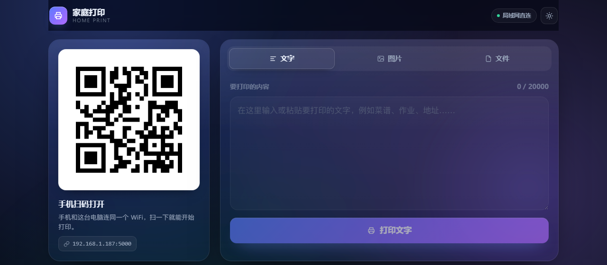
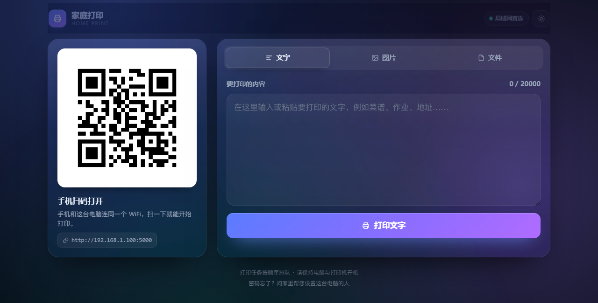
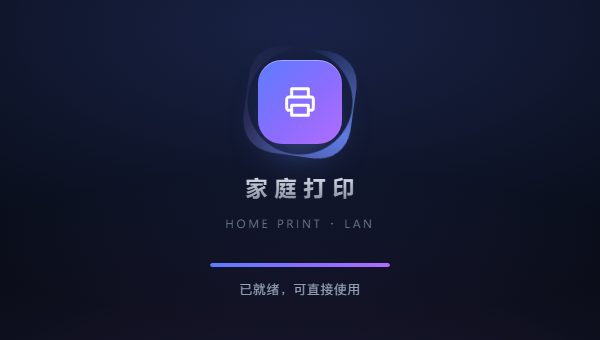
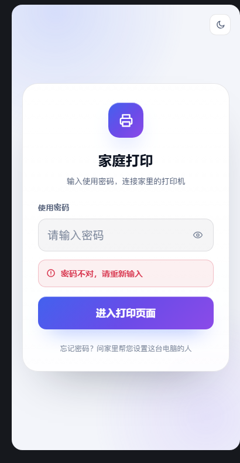
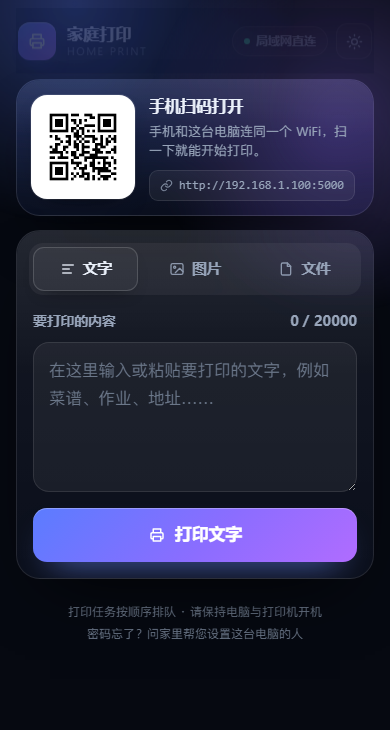
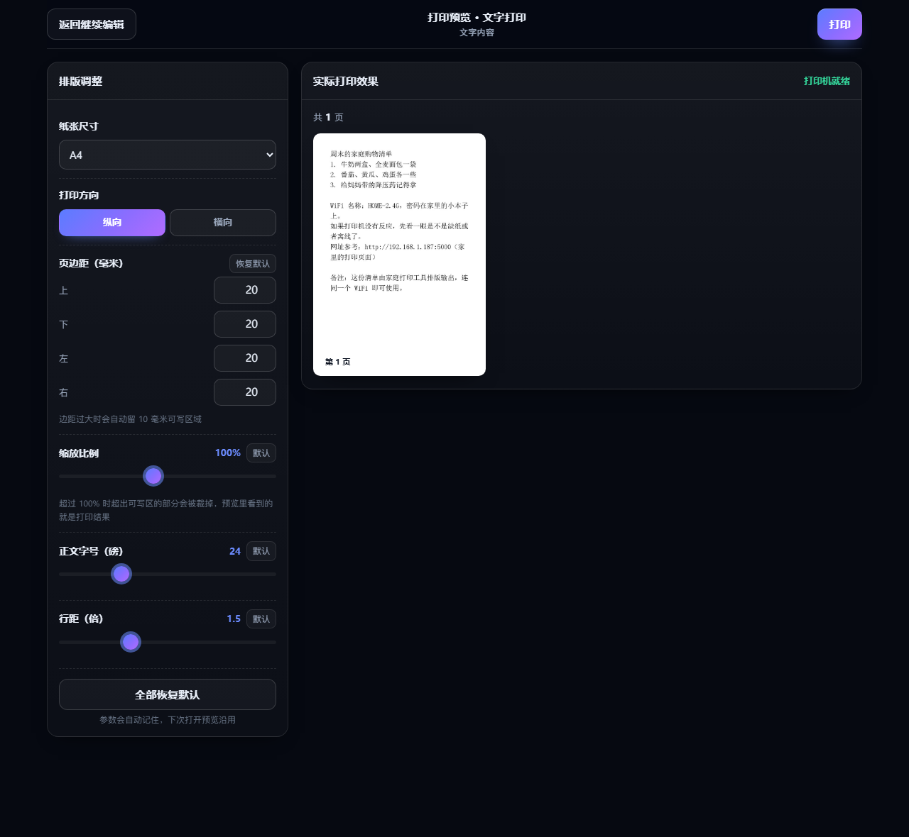
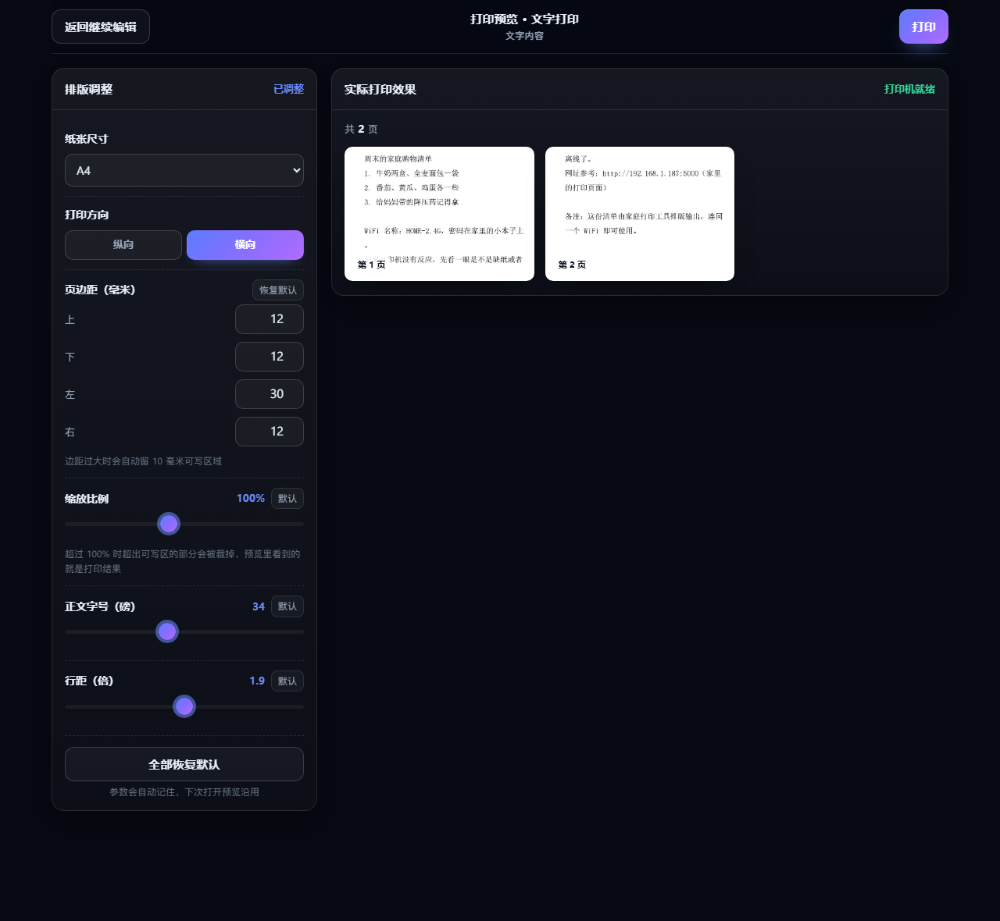
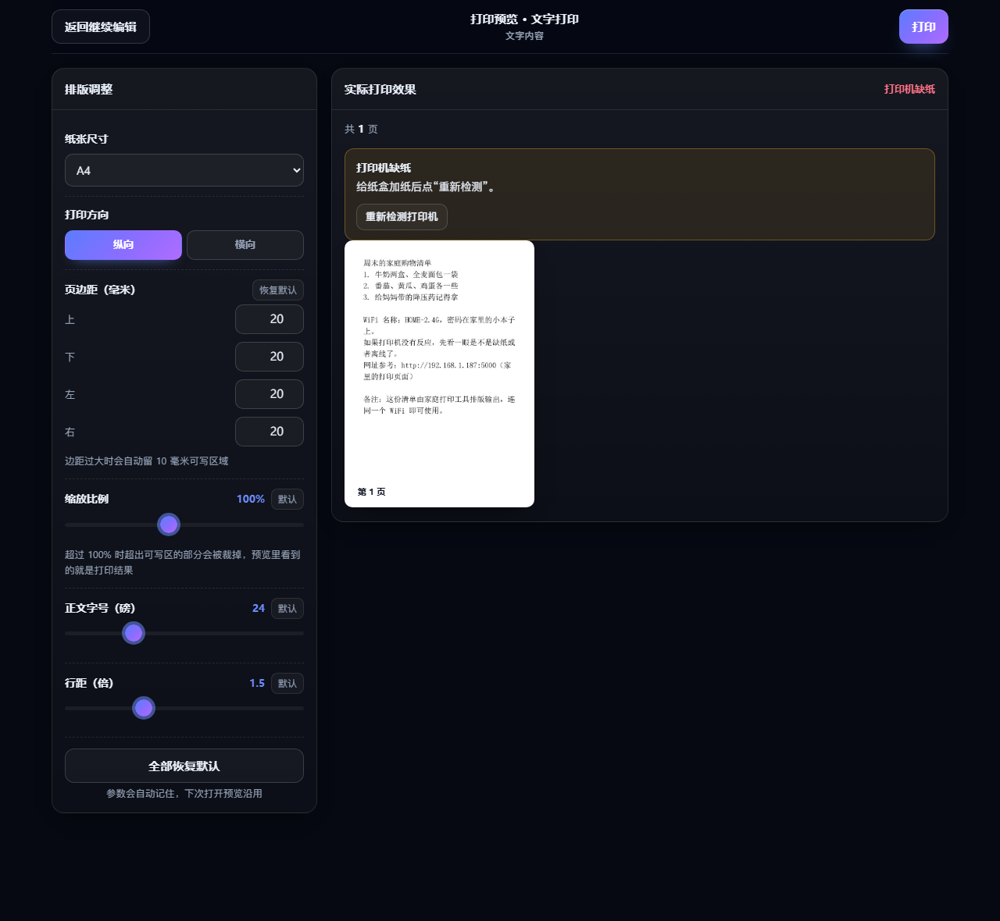
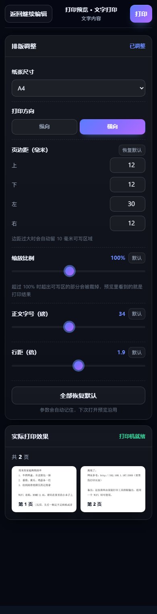

<div align="center">



**A dead-simple home print server for Windows. Phones on the same Wi-Fi scan a QR code, enter a shared password, and print text, photos, or files from the phone / WeChat chat history.**

English · [简体中文](README.md)

[](CHANGELOG.md)
[](https://github.com/ShirakawaFM/family-lan-printer/actions/workflows/python-check.yml)
[](https://www.python.org/)
[](https://www.microsoft.com/windows)
[](LICENSE)
[](https://github.com/ShirakawaFM/family-lan-printer/issues)
[](https://github.com/ShirakawaFM/family-lan-printer/stargazers)

</div>

> This is **not** cloud printing. Text, images and files stay on your Windows PC and are deleted 30 seconds after each print job. Files that are only previewed are cleaned up after 30 minutes. No accounts, no telemetry, no ads.

---

## Which download?

The release has two packages:

| Version | Best for | Download |
| --- | --- | --- |
| **LAN version** | Same Wi-Fi only; simplest, no VPS | [family-lan-printer-lan-v1.2.0.zip](https://github.com/ShirakawaFM/family-lan-printer/releases/download/v1.2.0/family-lan-printer-lan-v1.2.0.zip) |
| **Public deployment version** | 4G/5G access; needs a VPS | [family-lan-printer-public-v1.2.0.zip](https://github.com/ShirakawaFM/family-lan-printer/releases/download/v1.2.0/family-lan-printer-public-v1.2.0.zip) |

Both include `print_server.py`, dependencies, README and screenshots. The public package also includes `deploy-public/` with fill-in sheets, frps/frpc scripts and an optional HTTPS guide.

---

## Which build to download

The releases page ships two archives — pick one:

| Build | For | Download |
| --- | --- | --- |
| **LAN build** | home use on the same Wi-Fi, no cloud server needed | [family-lan-printer-lan-v1.2.0.zip](https://github.com/ShirakawaFM/family-lan-printer/releases/download/v1.2.0/family-lan-printer-lan-v1.2.0.zip) |
| **Public build** | access over 4G/5G, needs a cloud server | [family-lan-printer-public-v1.2.0.zip](https://github.com/ShirakawaFM/family-lan-printer/releases/download/v1.2.0/family-lan-printer-public-v1.2.0.zip) |

Both contain the full `print_server.py`, `requirements.txt`, both READMEs and the screenshots. The public build additionally contains `deploy-public/`: the fill-in sheet, the cloud/Windows one-shot scripts and the optional HTTPS guide.

> If you are unsure, take the **LAN build**. The public build involves a cloud server, security groups and frp; follow the guide inside the archive.

Both archives are built by GitHub Actions on tag push (`tools/build_release.py`) and are reproducible: identical content always yields the same SHA256, which is published in the release notes.

## Three steps to run it

<div align="center">
<code>① install deps</code>&nbsp; → &nbsp;<code>② set the password</code>&nbsp; → &nbsp;<code>③ start &amp; scan</code>
</div>

```bat
:: 1) deps (once)
python -m pip install -r requirements.txt

:: 2) open print_server.py and change ACCESS_PASSWORD (default: 123456)

:: 3) start the server, print qr_wall.png and stick it next to the printer
python print_server.py
```

No app, no sign-up, no internet needed: **join the same Wi-Fi → scan the QR with WeChat → enter the password → print.** Full walkthrough in [Quick start](#quick-start) below.

<div align="center">
<a href="#why">💡 Why</a>&nbsp; · &nbsp;<a href="#preview">🖼️ Preview</a>&nbsp; · &nbsp;<a href="#features">✨ Features</a>&nbsp; · &nbsp;<a href="#how-it-works">⚙️ How it works</a>&nbsp; · &nbsp;<a href="#configuration">🔧 Config</a>&nbsp; · &nbsp;<a href="#faq">❓ FAQ</a>&nbsp; · &nbsp;<a href="README.md">🇨🇳 中文</a>
</div>

---

## Why

The printer is connected to a Windows PC at home. Printing a photo or a note usually means: find the PC, find the file, open it, click print. Elderly parents and children cannot do that alone.

This project reduces it to:

1. Run one Python file on the Windows PC.
2. Print `qr_wall.png` and stick it next to the printer.
3. Phone on the same Wi-Fi: scan → enter password → type or choose a photo → tap print.

## Preview

### Desktop · dark theme (follows the system by default)

> The QR code in the screenshots is a demo link (`http://192.168.1.100:5000`), not a real address.

<div align="center">
<a href="docs/screenshot-print.png"></a>
</div>

<details>
<summary><b>Light theme / mobile / password page / splash</b></summary>

<br>

<table>
<tr>
<td align="center" width="50%">
<a href="docs/screenshot-print-light.png"></a>
<br><sub><b>Desktop · light theme</b> — toggle in the top-right corner, follows the system preference</sub>
</td>
<td align="center" width="50%">
<a href="docs/screenshot-splash.png"></a>
<br><sub><b>Branded splash</b> — ~1 s, fades out as soon as the page is ready</sub>
</td>
</tr>
<tr>
<td align="center" width="50%">
<a href="docs/screenshot-login.png"></a>
<br><sub><b>Password page</b> — one shared family password, no sign-up</sub>
</td>
<td align="center" width="50%">
<a href="docs/screenshot-print-mobile.png"></a>
<br><sub><b>Mobile print page</b> — the QR card collapses into a strip so the input is visible immediately</sub>
</td>
</tr>
</table>

<br>

<table>
<tr>
<td align="center" width="50%">
<a href="docs/screenshot-preview.png"></a>
<br><sub><b>Preview page</b> — layout editor on the left, live re-pagination on the right</sub>
</td>
<td align="center" width="50%">
<a href="docs/screenshot-preview-landscape.png"></a>
<br><sub><b>Landscape + large font</b> — what you see is what the printer outputs</sub>
</td>
</tr>
<tr>
<td align="center" width="50%">
<a href="docs/screenshot-preview-printer-error.png"></a>
<br><sub><b>Printer problem</b> — the reason and the fix, before you waste paper</sub>
</td>
<td align="center" width="50%">
<a href="docs/screenshot-preview-mobile.png"></a>
<br><sub><b>Mobile preview</b> — same controls, stacked for a phone screen</sub>
</td>
</tr>
</table>

</details>

The UI uses a modern, motion-rich style: dark/light themes (follows the system, manual toggle included), gradient glow background, glassy cards, tabbed print modes and spring micro-interactions. A ~1 s branded splash animation plays on the print page and fades out as soon as the page is ready. Buttons stay large and full-width (56 px tall, 16 px+ font) so touch use by kids and grandparents is unaffected. Files show three thumbnail pages on the print page, then go through the preview page before anything is printed.

## Features

- **QR access** — detects the LAN IPv4 automatically, serves the page at `http://<ip>:5000`, and exports a print-ready `qr_wall.png`.
- **Shared password** — one family password, not a user account system. The console only prints a masked version.
- **A4 text printing** — SimSun, 24 pt, left aligned, 20 mm margins, automatic wrapping and pagination.
- **Photo printing** — jpg / png / webp, max 8 MB; EXIF orientation fixed, aspect ratio preserved, centered on A4, no stretching or cropping.
- **Phone / WeChat chat files** — pick PDF, Word, Excel, PowerPoint, TXT, HTML or images. Inside WeChat the chat conversation opens directly, with no "save to phone" step; outside WeChat it falls back to the native file picker.
- **Mandatory print preview** — all three entries (text / image / file) open a preview page first. It ships a layout editor: paper size, orientation, per-side margins, scale, font size and line spacing. Every change re-paginates live and matches the printer output exactly. Two exits only: **Print** or **Back to editing** (cancel changes nothing).
- **Printer self-check on startup** — a background probe reports the default printer status (ready / out of paper / offline / ...) in a status bar, with a re-check button and a shortcut to the Windows printer settings. It never blocks startup.
- **Serial print queue** — one worker consumes `queue.Queue`; jobs never print concurrently.
- **Auto cleanup** — every temp file is deleted 30 seconds after its job ends; preview-only files expire after 30 minutes.
- **Friendly errors** — the browser shows the likely cause (paper out, paper jam, offline, door open, no toner, etc.) and a matching fix; stack traces and English error codes stay in the console.
- **Optional remote access** — a complete frp tutorial is included at the end of the Python file. The web UI never displays an external QR code.
- **Single-file deployment** — no frontend build, database, Docker, or cloud dependency.
- **One-click-ish setup** — `pip install -r requirements.txt`, then `python print_server.py`.

**Out of scope:** OCR, WeChat bots, cloud sync, Wi-Fi setup QR codes, user registration, and uploading anything to an external server. WeChat picking uses the official `chooseMessageFile` JS-SDK: WeChat shows the conversation file list and only files the user actively picks are handed to the page. The chat database is never read or uploaded.

## How it works

```text
Phone / WeChat browser
        │ HTTP on the same Wi-Fi
        ▼
Flask 0.0.0.0:5000
  ├─ GET   /                      password page / print page
  ├─ POST  /unlock                shared password → session
  ├─ GET   /qr.png                LAN QR (immutable cache)
  │
  ├─ preview session (the only print path)
  │   ├─ POST /preview/text          text → session
  │   ├─ POST /preview/image         image → session
  │   ├─ POST /preview/file          file → session
  │   ├─ POST /preview/file/<id>     prepared file → session
  │   ├─ GET  /preview/<id>          preview page (layout editor)
  │   ├─ POST /preview/<id>/render   re-paginate with the current layout
  │   ├─ POST /preview/<id>/print    only now → print queue
  │   └─ POST /preview/<id>/cancel   discard, source untouched
  │
  ├─ POST  /print/file            file preparation (preview only)
  ├─ GET   /status/printer        cached printer self-check snapshot
  ├─ POST  /status/printer/refresh   re-run the probe
  ├─ GET   /wechat/jsconfig       WeChat JS-SDK signature
  └─ GET   /status/<id>           printing / done / error
        │
        ▼
queue.Queue (FIFO)
        ▼
single print-worker thread
  ├─ text: Pillow → A4 pages
  ├─ image: EXIF + contain + center on A4
  ├─ PDF: pypdfium2 render pages
  ├─ Office: COM → PDF → render pages
  ├─ PPT: Slides.Export → PNG → A4 pages
  └─ pywin32 / win32ui → Windows default printer
        │
        ▼
temp file deleted 30 s after the job ends
```

The single-consumer queue exists for a reason: concurrent `StartDoc` calls can confuse spooler/driver combinations, reorder jobs, or lock up the printer. One worker means strict FIFO.

## Quick start

### Requirements

| Item | Requirement |
| --- | --- |
| OS | Windows 10 / 11 |
| Python | 3.10+ (tested on 3.14) |
| Python deps | Flask, Pillow, qrcode, pypdfium2, pywin32 |
| Printer | installed in Windows and set as **default** |
| Network | PC and phone on the same Wi-Fi |
| Paper | A4 |
| Office | Microsoft Office is required for Word/Excel/PPT layout conversion; PDF/TXT/HTML/images work without it |

### Install

```bat
cd /d D:\family-print
python -m pip install -r requirements.txt
```

### Change the password

In `print_server.py`:

```python
ACCESS_PASSWORD = "123456"
```

Change it before exposing the service to your family. `123456` is only a first-run default.

### Run

```bat
python print_server.py
```

The console prints:

```text
✅ LAN URL: http://192.168.1.100:5000
✅ Wall QR exported: qr_wall.png
✅ Access password: 1****6
✅ Keep the PC and printer powered on.
ℹ️ Web service is ready; finishing the last steps in the background…
🖨️ Default printer ready: hp LaserJet 1010 HB (probed in the background)
```

Allow Python through Windows Firewall for **Private networks** when prompted. Keep the console window open.

### Print the wall QR

Print `qr_wall.png` from the project folder and stick it next to the printer. Scan with WeChat, enter the password, and print.

## Print preview (mandatory)

```text
print page  ──►  POST /preview/...  ──►  GET /preview/<id>  ──►  [ Print ]  ──►  queue
   ▲                                        │  ▲                                  
   │                                        │  │  layout change                   
   └──────  cancel / back (nothing written) ─┘  └─► POST /preview/<id>/render      
```

- All three entries (text, image, file) land on the preview page. Direct calls to `POST /print/text`, `POST /print/image` or `POST /print/file/<id>` are rejected with **HTTP 403** (`need_preview`), so no shortcut, batch action or legacy button can bypass the preview.
- The editor exposes paper size (A4 / A5 / B5 / Letter / Legal), orientation, four independent margins, scale, body font size and line spacing:

  | Control | Range |
  | --- | --- |
  | Margins | 0–60 mm per side |
  | Scale | 25–200 % |
  | Font size | 6–72 pt |
  | Line spacing | 0.8–3.0 |

- Everything is computed in millimetres and points and converted to pixels only at the last step, so the 96 DPI preview and the 300 DPI print share one geometry: same page breaks, same wrapping, same clipping.
- The preview page has exactly two exits. **Print** queues the job; **Back to editing** discards the session and leaves the original content byte-for-byte unchanged.
- Every control has a one-click reset, and the last used layout is remembered for the next job.

## Picking files from WeChat

Inside WeChat the **Pick from WeChat chat** button calls `wx.chooseMessageFile` directly, so files are read straight from the conversation — no "save to phone, then upload" detour. Outside WeChat (or when the JS-SDK is not configured) the button hides or falls back to the native file picker, and the rest of the flow is identical.

| Capability | Detail |
| --- | --- |
| Entry | WeChat built-in browser only (`MicroMessenger` UA) |
| Requirement | `WECHAT_JSAPI_ENABLED = True` plus a public-account `AppID` / `AppSecret`, and the domain registered as a JS API security domain |
| Source | Files that appeared in the current user's chats |
| Types | Whatever the chat holds; the server still validates by extension and real content |
| Count | Up to 100 files per `chooseMessageFile` call (WeChat limit) |
| Size | Capped by `FILE_MAX_BYTES` (50 MB) |

| Failure | Fallback |
| --- | --- |
| Not opened in WeChat | Button hidden, native file picker used |
| AppID / AppSecret missing or signature fails | Native file picker used |
| User cancels the picker | Return to the page, nothing submitted |
| `chooseMessageFile` unsupported / call fails | Native file picker used, **not** an error notification |
| File over the size limit or wrong type | Same message as the native picker path |

The fallback never blocks the main flow: it does not pop a confusing WeChat error, does not require the user to retry in a different way, and the picked file goes through exactly the same validation and preview.

## Printer self-check on startup

A background thread probes the default printer right after the port is bound. The result is cached and served by `GET /status/printer`; the web UI shows a status bar with a **Re-check** button and a link to `ms-settings:printers`.

| State | UI | Action offered |
| --- | --- | --- |
| `ok` | Ready, with the printer name | None |
| `no_printer` | No default printer set | Open Windows printer settings |
| `offline` / `error` / `paper_out` / `paper_jam` / `toner_low` / `door_open` / `paused` | Reason + matching fix | Re-check, open printer settings |
| `unknown` | Could not confirm the state | Re-check (8 s timeout) |

- The probe runs on a daemon thread with a concurrency guard and an 8-second timeout. **Startup never waits for it**, so "scannable" is not delayed by a slow or absent spooler.
- The snapshot is reused for later requests, so repeated page loads cost nothing.

## Configuration

All values live at the top of `print_server.py`:

| Option | Default | Description |
| --- | --- | --- |
| `HOST` | `0.0.0.0` | Listen on all interfaces |
| `PORT` | `5000` | HTTP port |
| `ACCESS_PASSWORD` | `123456` | Shared family password; change it |
| `ENABLE_FRP_GUIDE` | `True` | Console hint for the frp tutorial; never shows an external QR |
| `EXPORT_QR_IMAGE` | `True` | Write `qr_wall.png` on startup |
| `QR_WALL_FILENAME` | `qr_wall.png` | Wall QR file name |
| `LAN_IP_OVERRIDE` | `""` | Manual LAN IPv4 for multi-NIC/VPN machines |
| `TEMP_DIR_NAME` | `temp_print` | Temp directory |
| `PAGE_MARGIN_MM` | `20.0` | A4 margin in millimetres |
| `TEXT_FONT_SIZE_PT` | `24` | Text size in points |
| `TEXT_LINE_SPACING` | `1.5` | Line-height multiplier |
| `RENDER_DPI` | `300` | Page render DPI |
| `IMAGE_MAX_BYTES` | `8388608` | 8 MB image limit |
| `MAX_IMAGE_PIXELS` | `50000000` | Pixel limit to avoid memory blow-ups |
| `MAX_TEXT_CHARS` | `20000` | Text limit per job |
| `FILE_MAX_BYTES` | `52428800` | Phone/chat file limit, 50 MB |
| `FILE_PREVIEW_PAGES` | `3` | Pages shown in the phone preview |
| `FILE_PREVIEW_DPI` | `96` | Preview render DPI |
| `PDF_PRINT_DPI` | `200` | PDF print render DPI |
| `MAX_FILE_TEXT_CHARS` | `50000` | Text-file limit |
| `FILE_TTL_SECONDS` | `1800` | Unprinted preview lifetime |
| `DELETE_AFTER_SECONDS` | `30` | Temp-file retention after a job |
| `SESSION_LIFETIME_DAYS` | `30` | Login session lifetime |
| `REQUIRE_PREVIEW` | `True` | Enforce preview-before-print; set `False` to restore direct printing |
| `PREVIEW_TTL_SECONDS` | `1800` | Preview session lifetime |
| `MAX_PREVIEW_SESSIONS` | `20` | Concurrent preview sessions before the oldest is dropped |
| `PREVIEW_DPI` | `96` | Preview render DPI (same geometry as printing) |
| `PREVIEW_MAX_RETURN_PAGES` | `9` | Pages returned per render request |
| `PREVIEW_MAX_RENDER_PAGES` | `40` | Hard cap on pages generated per render |
| `PREVIEW_THUMB_EDGE` | `760` | Preview image long edge in pixels |
| `PAGE_SIZES_MM` | A4/A5/B5/Letter/Legal | Paper sizes offered in the editor |
| `DEFAULT_PAGE_SIZE` | `A4` | Default paper |
| `DEFAULT_ORIENTATION` | `portrait` | Default orientation |
| `DEFAULT_SCALE_PERCENT` | `100.0` | Default scale |
| `LAYOUT_LIMITS` | margins 0–60 mm / scale 25–200 % / font 6–72 pt / line spacing 0.8–3.0 | Clamping bounds |
| `PDF_USE_LAYOUT_PAGE` | `True` | Let PDF pages follow the chosen paper and margins |
| `PRINTER_PROBE_ENABLED` | `True` | Startup printer self-check |
| `PRINTER_PROBE_TIMEOUT` | `8.0` | Probe timeout in seconds |
| `WECHAT_JSAPI_ENABLED` | `False` | WeChat JS-SDK chat file picking |
| `WECHAT_APPID` | `""` | Public-account AppID; blank falls back to the native picker |
| `WECHAT_APPSECRET` | `""` | Public-account AppSecret; blank falls back to the native picker |

## Print rules

### Text

- A4 portrait by default; A5 / B5 / Letter / Legal can be chosen in the preview
- SimSun 24 pt by default, 6–72 pt in the preview (falls back to Microsoft YaHei / DengXian / SimHei)
- Left aligned
- 20 mm margins by default, 0–60 mm per side in the preview
- 1.5 line spacing by default, 0.8–3.0 in the preview
- Automatic line wrapping and pagination
- No layout controls on the print page; they all live in the mandatory preview page

> These are the **defaults**. Preview-time layout applies to that one job only: the source text is never rewritten.

### Images

- jpg / jpeg / png / webp, max 8 MB
- EXIF orientation corrected
- Aspect ratio preserved, scaled to fit the A4 content area
- Centered, never stretched; an additional 25–200 % scale is available in the preview
- Transparent areas flattened onto white
- Default layout (100 % + A4 + 20 mm) is pixel-identical to the pre-preview behaviour; pushing margins or scale past the sheet clips exactly as it will print

### Printer

- Uses the Windows default printer only.
- One background self-check at startup; the result stays visible in a status bar (see [Printer self-check on startup](#printer-self-check-on-startup)).
- Best-effort preflight status check for paused, error, paper jam, paper out, offline, no toner, door open, etc.
- Some drivers do not report status; in that case the spooler result is all we can know.
- Set the printer paper size to A4, or to whatever paper you picked in the preview.

## Security

- Shared password + signed session cookie; no user registration.
- The wall QR contains only the LAN URL.
- The web UI never renders a public/external QR code.
- Temp files are deleted 30 seconds after each job.
- No cloud services, no third-party APIs, no telemetry.
- Frontend errors are fixed Chinese messages; details go to the console.
- Uploaded images are checked by extension, size, real Pillow format, and pixel count.

If you expose this through frp, use a strong password, a strong frp token, and HTTPS (Nginx/Caddy). Plain HTTP over the public internet exposes the password in transit.

## Public deployment pack (optional)

The web UI intentionally only shows the LAN QR. For 4G/5G access, use the ready-made pack in [`deploy-public/`](deploy-public/README.md) instead of writing frp configs by hand.

The pack contains:

- [`01-先填-部署信息.txt`](deploy-public/01-先填-部署信息.txt): fill in every `（）` placeholder;
- [`server/02-云服务器-运行这个.sh`](deploy-public/server/02-云服务器-运行这个.sh): one-shot frps installer for Ubuntu;
- [`windows/03-家里电脑-运行这个.ps1`](deploy-public/windows/03-家里电脑-运行这个.ps1): downloads frpc, writes config, creates a startup shortcut;
- [`00-先看-公网部署教程.md`](deploy-public/00-先看-公网部署教程.md): full walkthrough and troubleshooting;
- [`optional-https/HTTPS-可选教程.md`](deploy-public/optional-https/HTTPS-可选教程.md): optional Caddy HTTPS.

Quick flow: open `7000/tcp` and `6000/tcp` in the cloud firewall, run the server script, run the Windows script with the same token, then open `http://YOUR_PUBLIC_SERVER_IP:6000` on 4G.

> Plain HTTP exposes the password in transit. Use the optional HTTPS guide for long-term use, and change `ACCESS_PASSWORD` before exposing anything.

## Windows autostart

Use Task Scheduler instead of the Startup folder:

1. `Win + R` → `taskschd.msc`.
2. Create Task (not Create Basic Task).
3. General: run only when the user is logged on.
4. Trigger: at logon, delay 30 seconds.
5. Action: start `python.exe` or `pythonw.exe`.
6. Arguments: `"D:\family-print\print_server.py"`.
7. Start in: `D:\family-print`.
8. Allow restart on failure; disable the "stop task if it runs longer than" option.

Start with `python.exe` so you can see the console. Switch to `pythonw.exe` only after everything works.

## Project layout

```text
family-lan-printer/
├─ print_server.py          # Flask app, print worker, queue, HTML UI, docs comments
├─ requirements.txt
├─ README.md
├─ README_EN.md
├─ LICENSE
├─ CHANGELOG.md
├─ assets/                       # animated SVG for READMEs
│  ├─ banner.svg / banner-en.svg
│  ├─ pipeline.svg
│  ├─ divider.svg
│  └─ footer.svg
├─ docs/screenshot-login.png
├─ docs/screenshot-print.png
├─ docs/screenshot-print-light.png
├─ docs/screenshot-print-mobile.png
├─ docs/screenshot-splash.png
├─ docs/screenshot-preview.png
├─ docs/screenshot-preview-landscape.png
├─ docs/screenshot-preview-printer-error.png
├─ docs/screenshot-preview-mobile.png
├─ docs/social-preview.png
├─ deploy-public/             # public deployment pack and fill-in sheets
└─ .github/workflows/python-check.yml
```

Runtime-only files (ignored by Git):

```text
temp_print/
qr_wall.png
frp/, frpc.toml, frpc.log
server.log
server.err.log
```

## Known limitations

- Windows only; uses `pywin32` and the Windows printing API.
- Default printer only; no printer picker.
- Printer status is best-effort and driver-dependent.
- A4 portrait is the default layout; the printer paper size must match the paper you pick in the preview.
- If the PC's LAN IP changes, regenerate and reprint `qr_wall.png`.
- `pythonw.exe` hides the console and therefore the logs.
- Phone and PC must be on the same LAN; guest Wi-Fi / AP isolation will block access.
- Word/Excel/PPT need Microsoft Office installed for layout-preserving conversion; otherwise save as PDF first.
- WeChat chat picking needs the WeChat built-in browser plus an AppID/AppSecret with the domain registered as a JS API security domain. Otherwise the native file picker is used, with no error and no interruption.
- `chooseMessageFile` allows at most 100 files per call and only files present in the user's chats.
- Layout values are clamped to `LAYOUT_LIMITS`, so negative margins or a 0 pt font are impossible.
- The preview returns at most `PREVIEW_MAX_RETURN_PAGES` pages (9); printing still outputs every page.
- Text and chat exports are reflowed; PDF/Office/PPT keep their original layout.

## FAQ

**`ERR_CONNECTION_REFUSED` on the phone.** The server is not running or the console was closed. Open `http://127.0.0.1:5000` on the PC first, then use the LAN URL shown in the console and check Windows Firewall.

**PC opens the page but the phone does not.** Check same Wi-Fi, AP isolation, firewall, and `LAN_IP_OVERRIDE` for multi-NIC/VPN machines.

**No default printer.** Set it in Windows Settings → Bluetooth & devices → Printers & scanners, then print a test page from Notepad.

**Photo upload fails.** Only jpg/png/webp up to 8 MB. Convert HEIC photos to jpg first.

**Where do I pick WeChat chat files?** Inside WeChat, use **Pick from WeChat chat** to open the conversation file list directly. If the button is missing or WeChat reports the API is unavailable, you are outside WeChat or the server has no AppID/AppSecret: the native file picker is used instead and works the same way.

**The status bar says "checking" forever.** The probe times out after 8 seconds and then shows "could not confirm". Use **Re-check** to run it again; preview and printing are never blocked.

**Did the preview change my text?** No. Layout values apply to that one job. **Back to editing** leaves your original content untouched, and **Print** is the only thing that produces paper.

**I want to skip the preview.** Set `REQUIRE_PREVIEW = False` at the top of `print_server.py` to restore direct printing. The default stays `True`.

**File preview fails / Office cannot open.** Make sure the file opens in Word/Excel/PowerPoint on the PC. Without Microsoft Office, save it as PDF first. PDF/TXT/HTML/images do not need Office.

**Where are WeChat chat files?** Inside WeChat, use **Pick from WeChat chat** to open the conversation file list directly. If the button is missing or WeChat reports the API is unavailable, you are outside WeChat or the server has no AppID/AppSecret: the native file picker is used instead and works the same way.

**Why does the preview page show only a few pages?** To keep the phone fast. It returns at most 9 pages and the header shows the total; **Print** still outputs every page.

**Why no "print completed" message?** Windows spooler accepts a job before paper comes out. The UI only promises "queued" or "failed", not a fake completion event.

## Development

```bat
python -m py_compile print_server.py
python print_server.py
```

CI runs `py_compile` on a Windows runner. It does not print, because GitHub Actions has no printer.

Manual checklist:

1. Print one page from Notepad so the Windows printing path is known-good.
2. Start the server and check the printer status bar at the top of the print page.
3. Submit short text: the preview page must open, showing A4 / 24 pt / 20 mm and the right page count.
4. Push every control to its limit (A5, landscape, 0 mm margins, 200 % scale, 72 pt, 3.0 line spacing) and confirm the page count follows.
5. Reset all: values return to defaults and the page count matches step 3.
6. Back to editing: the original text is unchanged; re-entering the preview keeps your last layout.
7. `curl -X POST /print/text` directly: expect **403**, not a printed page.
8. Repeat the two QR regression checks before shipping a print-logic change.

## Contributing

Issues and pull requests are welcome. Please keep the project single-file, avoid frontend builds/databases/cloud services, and do not add out-of-scope features such as OCR, bots, or user accounts.

## License

[MIT](LICENSE) © 2026 ShirakawaFM

## Disclaimer

This is a personal home tool, not a supported commercial product. Use it at your own risk. The author is not responsible for failed prints, wasted paper, driver issues, network exposure, or data loss.
